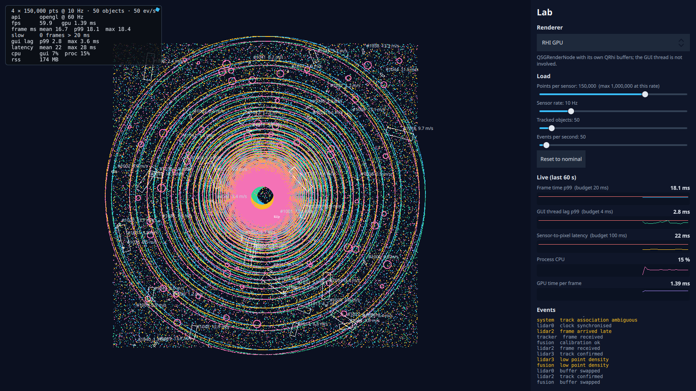

# Step 1: Live view with a lab panel

**What the user sees:** a top-down view of four fused lidar sensors with tracked objects, and a lab panel. From the panel you can switch live between six ways of drawing the points, change the load with sliders, and watch frame time, GUI lag, latency, CPU and GPU time in charts with their budget lines.

**The design question:** how should data flow from a sensor to a pixel, and who owns it on the way?



> **Intermediate:** We spent four experiments on this already. Why build it again?
>
> **Senior:** Because nobody could *see* any of it. The experiments proved four designs draw the same picture at very different cost. Now the product lets you flip between them and watch the cost change on screen. Same load, one dropdown apart:

| Same load (4 × 150k @ 10 Hz) | Painted item | RHI GPU |
|---|---|---|
| fps | 28.3 | 59.9 |
| Frame time p99 | 41.6 ms | 18.1 ms |
| GUI lag p99 | 172.9 ms | 2.8 ms |
| Latency | 102 ms | 22 ms |
| Process CPU | 101% | 15% |

(Screenshots: `results/step-01/screenshot-painted-nominal.png`, `screenshot-rhi-nominal.png`.)

## How it's built

```
SensorSimulator thread ──▶ LidarHub ──┬─ Canvas  ─(queued)─▶ CanvasFeed ─▶ JS Canvas          (experiment 01)
   (live workload changes)  (route =  ├─ Store   ─(queued)─▶ FrameStore ─▶ PointCloudView      (experiment 02)
                             active   ├─ Pipeline ─────────▶ lanes + workers ─▶ PointLayersView (experiment 03)
                             renderer)└─ Mailbox  ─────────▶ LidarMailbox ─▶ SG / RHI / Quick 3D (experiment 04)

Lab (QML singleton from main): renderer, load sliders, caps.  FrameMonitor: charts.
```

> **Intermediate:** Why does the hub only feed the active renderer?
>
> **Senior:** So switching is fair. If all six received every frame, the cheap ones would pay for the expensive ones, and the charts would lie.

- **Live load changes.** The simulator rebuilds only what changed, on its own thread. Going to 1M points takes up to 0.62 s on the simulator thread, while the GUI thread's worst stall is 17 ms.
- **Caps in points per second.** Each renderer has a sustainable rate, and the slider's maximum follows the sensor rate.
- **Quick 3D is created on first use and then kept.** Destroying a `View3D` leaves GPU resources queued until exit.
- **Charts are one scene-graph node each.** No JavaScript, no Canvas.

## Predictions against measurements

Predictions: [`results/step-01/predictions.md`](../../results/step-01/predictions.md). Summary: [`results/step-01/summary.md`](../../results/step-01/summary.md).

| Prediction | Measured | |
|---|---|---|
| Each renderer within ±15% of its experiment | GPU time +5% (sg, rhi, quick3d) and +32% (worker); latency within 1%; process CPU 10–31% **lower** | Wrong, and explained below |
| The panel costs +1–3 pp GUI CPU and +0.05–0.2 ms GPU | GPU +0.001–0.007 ms; GUI difference below this machine's noise once normalised by the canary | Cheaper than predicted |
| All six renderers draw the same picture | Yes, after two fixes | Right after fixes |
| Switching: new content within 0.5 s, clean stderr, RSS within 20 MB after 30 switches | 15–21 ms p50, 51 ms max; clean after one fix; memory floor flat at 231 MB across 200 switches | Right after fix |
| Load change visible within 1 s; GUI never blocks | Rebuild 172–184 ms p50, 0.62 s max (+250 ms debounce); GUI lag max 17 ms | Right |
| The panel can't push the app into an unrecoverable state | **Wrong at first:** the JS Canvas path at 50k × 20 Hz reached 0.8 fps and 7.5 GB, and was killed. Fixed by capping points per second | Right after fix |

> **Intermediate:** Why are the renderers *cheaper* in the app than in their experiments?
>
> **Senior:** The event log is shorter. A model reset rebuilds every *visible* row: 3.15 ms per batch with the experiments' 800 px log, 1.0 ms with the app's ~150 px log. That alone took GUI CPU from 12% to 7%, and GUI lag p99 from 5–6 ms to 2.8 ms, now inside the budget. The worker raster's extra GPU time is the bigger viewport: 1220 × 900 vs 1040 × 800 is 32% more pixels to upload and composite. Same design, different screen, different numbers. A benchmark is only valid for its layout.

### Every renderer at nominal (median of 3, interleaved)

| Renderer | fps | GUI lag p99 | Process CPU | GPU p50 | Latency p50 | RSS |
|---|---|---|---|---|---|---|
| JS Canvas (capped: 12k × 10 Hz) | 59.9 | 14–35 ms | – | 0.31 ms | 25–42 ms | 185–188 MB |
| Painted item | 35.9 | 147 ms | 96% | 0.25 ms | 68 ms | 179 MB |
| Worker raster | 59.9 | 3.1 ms | 57% | 0.54 ms | 35 ms | 211 MB |
| Scene graph GPU | 59.9 | 2.9 ms | 19% | 1.37 ms | 25 ms | 190 MB |
| **RHI GPU** | **59.9** | **2.8 ms** | **14%** | 1.39 ms | **25 ms** | **174 MB** |
| Quick 3D GPU | 59.9 | 4.8 ms | 18% | 1.54 ms | 25 ms | 203 MB |

Quick 3D missed 0, 21 and 27 frames in its three runs, while the scene graph and RHI missed 0–2. The two runs with misses also had a slower canary (2.87 and 3.04 ms against 2.56), so Quick 3D is more sensitive to a busy machine. Its GUI-thread copy is the likely reason, but that isn't proven.

## What the product caught that metrics didn't

1. **Canvas drew differently.** Pixel parity was 41%: Canvas antialiased its squares and every other renderer didn't. With antialiasing off it's pixel-identical. Experiment 01's Canvas numbers include antialiasing, so they are slightly pessimistic.
2. **Layer order changed between runs.** Worker threads finish in any order, and the raster layers stacked in arrival order, so 17,000 pixels differed between identical frozen runs. Layers now keep sensor order. The remaining ~120 differing pixels are glyph edges in the track labels.
3. **Quick 3D left resources behind.** Switching away destroyed the `View3D` and left GPU resources queued until exit (a warning at shutdown). It's now created once and hidden when inactive.
4. **A load test that never ran.** `Qt::UniqueConnection` with a lambda is rejected, with only a warning. The stderr capture caught it.
5. **A run vanished.** One benchmark ended early with exit 0 and no report, most likely the window being closed. Reports are now written on early quit, marked `aborted`, and retried.

## Memory checks

- **Switch soak, 5 min, 200 switches:** the RSS floor settles at 231 MB by cycle 5 and stays flat. No leak in switching.
- **Without Canvas, events on:** creeps ~1.2 MB/min. **With events off:** flat apart from two small allocator steps. The creep is the event log, which keeps every event (known; step 5).
- **Canvas → RHI recovery:** GUI lag back to 3–4 ms within 1 s of switching, and memory returns to 172–191 MB.
- **Canvas at the new cap:** flat at 185–188 MB. At 25k × 10 Hz (1M points/s) one run reached 888 MB. Per-frame array size matters, not only points per second, so the cap is 0.5M points/s.

> **Intermediate:** The charts are free?
>
> **Senior:** On this machine, cheaper than we can resolve. The canary, identical work in every run, swung 20–35% between groups during that test, and the chart difference vanished once normalised. That's a statement about the instrument as much as the charts. Next time we want a small number, we'll want a quieter machine or a direct timer around the thing itself.

## Decision

**Default renderer: RHI GPU.** It has the lowest CPU (14% at nominal, 25% at peak), keeps the GUI thread out of the data path (lag p99 2.8 ms), has the lowest memory, and passes pixel parity on both APIs.

| It would be the wrong choice if… | …then choose |
|---|---|
| The app must run on several Qt versions without rebuilding (QRhi has limited compatibility guarantees) | Scene graph GPU: public API, within ~4 pp CPU |
| The view becomes truly 3D (orbit camera, height, picking) | Quick 3D: next step's question |
| The target has no GPU worth the name | Worker raster: 57% CPU at nominal, but the GUI stays responsive |

## Run it

```bash
./scripts/check.sh
build/release/app/viewer                                   # the product
build/release/app/viewer --variant painted --points 150000 # start on another renderer
python3 scripts/parity.py app                              # all renderers draw the same picture
python3 scripts/sweep.py step-01                           # ~25 min
git checkout step-01                                       # this step's state
```
