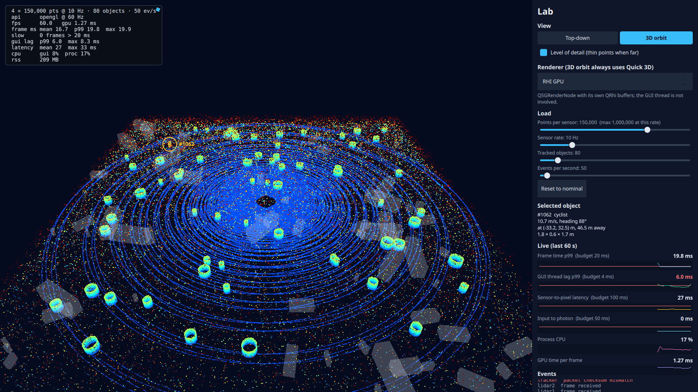

# Step 2: 3D orbit view and click-to-inspect

**What the user sees:** a "3D orbit" mode next to the top-down view. Drag to orbit, wheel to zoom. Points are coloured by height (ground blue, tall objects green to red), and tracked objects are 3D boxes. Click any object, in either view, to select it: it's highlighted, a ring and label follow it as the camera moves, and an inspector card shows its id, class, speed, heading, position, distance and size. A level-of-detail switch thins the points when the camera is far away. A sixth chart shows input-to-photon latency.

**The design question:** what does interactivity cost, and where should picking and level of detail live?



## Where picking lives

> **Intermediate:** Quick 3D already has `View3D.pick()`. Why write our own?
>
> **Senior:** Because "what did the user click?" is a question about the *data*, not the renderer. We have six renderers in the top-down view and one in 3D; they shouldn't each answer it differently. So picking lives in the domain: `TrackIndex`, a uniform grid over the track footprints, queried with a point (top-down) or a ray (3D), tested against each oriented box. It's plain C++, so it's unit-testable without a window. Then we check it against Quick 3D's picker on the same clicks.

- **Correctness:** 80,000 random point and ray queries match a brute-force search exactly (ids and hit distances), across 50–2,000 objects and three cell sizes (`app/tests/tst_trackindex.cpp`).
- **Cost of the query itself:** 0.72 µs at 2,000 objects.
- **Cost in the app:** dominated by rebuilding the index, which happens lazily on the first pick after tracks change. 18 µs at 50 objects, 334 µs at 2,000. Lazy is right because picks are rare and track updates arrive 10 times a second.

### Do the two pickers agree?

| Objects | Our pick (incl. rebuild) p50 | Quick 3D pick p50 | Same object |
|---|---|---|---|
| 50 | 20 µs | 53 µs | 100% |
| 200 | 55 µs | 132 µs | 100% |
| 800 | 153 µs | 440 µs | 93–96.5% |

> **Intermediate:** So ours is wrong 4–7% of the time at 800 objects?
>
> **Senior:** That's what the number says. I logged every disagreement with both ids and both hit distances. In 8 out of 9 our ray meets Quick 3D's box at *exactly* the same distance as ours: two overlapping boxes of the same class share a top face, and both pickers hit the same point. Ours breaks the tie by smaller id; Quick 3D takes whichever triangle it meets first. Both are right. That leaves one genuine difference in 258 clicks (0.4%): Quick 3D reported no hit where we hit a box at 112 m. Grazing an edge at long range is the likely reason, but it's unproven.

## What interaction costs

Input-to-photon is new: from an input event's timestamp to the swap of the first frame whose sync came after it. An input robot posts synthetic drags and clicks with our clock as the timestamp, so it can be measured without a person.

| Interaction (nominal load) | p50 | p99 | Waiting to be dispatched, p99 |
|---|---|---|---|
| 3D orbit drag | **25.6 ms** | 33.3 ms | 1.0 ms |
| Top-down click, RHI | **24.8 ms** | 33.4 ms | 1.0 ms |
| Top-down click, painted item | **97.9 ms** | 182.6 ms | **155 ms** |

> **Intermediate:** The painted item draws the same picture. Why is a click four times slower?
>
> **Senior:** Look at the last column. The click sat in the event queue for up to 155 ms before anyone looked at it, because the GUI thread was blocked waiting for the render thread to paint. Step 1 showed that as "GUI lag". Here it's what a user actually feels.

## Level of detail

At 4 × 600k points, 20 Hz, camera 300 m away:

| | LOD off | LOD on (every 4th point) |
|---|---|---|
| GPU per frame | 5.67 ms | **1.70 ms** |
| Copy on the GUI thread | 111 ms/s | 55 ms/s |
| GUI lag p99 | 5.7 ms | 3.2 ms |

What it costs the picture (`results/step-02/lod.md`):

| Distance | Stride | Lit pixels kept | Full-view pixels within 1 px of an LOD pixel |
|---|---|---|---|
| 300 m | 4 | 82% | 98.2% |
| 500 m | 8 | 87% | 98.1% |

The cloud looks about 18% sparser by pixel count, but almost everywhere it covers stays covered. The copy only halved, not quartered: a strided gather copies element by element, which is slower per byte than one `memcpy`.

## Predictions against measurements

Predictions: [`results/step-02/predictions.md`](../../results/step-02/predictions.md). Full table: [`results/step-02/summary.md`](../../results/step-02/summary.md).

| Prediction | Measured | |
|---|---|---|
| 3D at nominal: 60 fps, GPU 1.5–2.5 ms, lag ≤ 6 ms | 60 fps, 1.57 ms, 2.45 ms | Right |
| 3D at peak: 60 fps, GPU 3–4 ms | GPU 2.93 ms, but 65 missed frames and lag 8.6 ms | GPU right; frame budget missed |
| LOD: GPU 5–6 → 1.5–2.5 ms | 5.67 → 1.70 ms | Right |
| LOD: copy 4× cheaper | 2× | Wrong: strided gather |
| LOD: lit pixels differ < 10% | 18% fewer; 98% within 1 px | Wrong on count, right on coverage |
| Input: orbit p50 25–35, p99 < 50 ms | 25.6 / 33.3 ms | Right |
| Input: top-down RHI p50 20–35 ms | 24.8 ms | Right |
| Input: painted p50 > 100 ms | 97.9 ms (p99 183) | Just under |
| Our pick < 50 µs at 2,000 | Query 0.72 µs; with lazy rebuild 338 µs | Right for the query |
| Quick 3D pick 0.1–0.3 ms at 50, 1–3 ms at 800 | 0.05 / 0.44 ms | Cheaper than predicted |
| Pickers agree ≥ 99% | 93–96.5% by id; 99.6% by hit point | Wrong by id; explained (ties) |
| Quick 3D adds 30–60 MB | +30 MB | Right |

## Found along the way

1. **A name hid the base class.** `LidarGeometry` got an LOD property called `stride`; `QQuick3DGeometry::setStride()` already means "bytes per vertex". The constructor's `setStride(12)` set the LOD instead, and Qt warned "0 is an invalid stride" on every frame. Renamed to `pointStep`.
2. **The custom material drew nothing.** The docs say a default `POSITION` is generated when the vertex shader doesn't assign it. With `POINT_SIZE` assigned and `POSITION` not, every point landed on one spot. Writing `POSITION` explicitly fixed it. Without Qt's sources I can't say why, so the comment records what was observed.
3. **The inspector saw a new id with old info.** `select()` announced the id before refreshing the info, and the binding hit an undefined field. Now info is updated first.
4. **The input robot never started.** It looked for the viewport under `contentItem`, but items declared in a window are QObject children of the window itself. A robot that can't start now fails loudly.
5. **The selection was invisible at distance.** The highlighted box was 13 × 18 pixels. A ring and label now follow it in screen space.
6. **The marker cost most of the GUI budget.** Searching 800 boxes in JavaScript every frame cost 0.9 ms (p99 3.2 ms). Caching the selected box, refreshed only when the selection or the boxes change, makes it 60 µs at any object count.

## Open: 3D does not scale with object count

At 2,000 objects the 3D view collapses: 1.5 fps, an 8.5 s stall, force-killed. At 800 it runs at 53 fps with 197 missed frames. Every 10 Hz track update resets the model, and the `Repeater3D` destroys and recreates every box. The top-down view has the same pattern, but its delegates are cheaper. This is the next design pressure: step 5 (change propagation) and instancing.

## Decision

**Picking lives in the domain (`TrackIndex` + `Selection`); renderers only turn a click into a point or a ray.** It answers the same way in every view, it's tested without a window, and it's cheaper than Quick 3D's picker at every object count measured.

| It would be the wrong choice if… | …then |
|---|---|
| Objects were arbitrary meshes, not boxes | Use the renderer's triangle picking, which already knows the geometry |
| Picks were continuous (hover) and tracks changed every frame | Rebuild the index on update, or update it incrementally, instead of lazily per pick |
| Ties matter to the user | Prefer the box whose centre is nearest the hit point, not the smaller id |

## Run it

```bash
build/release/app/viewer --set view=orbit                # 3D
build/release/app/viewer --set view=orbit --set robot=orbit   # watch the robot drive the camera
python3 scripts/sweep.py step-02                         # ~13 min
python3 scripts/lod_check.py                             # what LOD costs the picture
git checkout step-02
```
