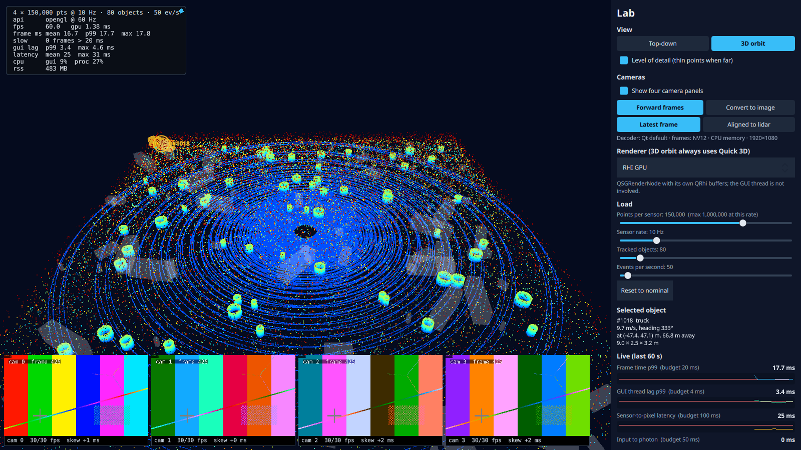

# Step 3: Camera panels in sync with the lidar

**What the user sees:** four 1080p camera panels along the bottom of the view, each labelled with its displayed and decoded frame rate and its time offset from the lidar. In the lab panel you choose how frames reach the screen (*forward* or *convert to image*) and how the cameras sync (*latest frame* or *aligned to lidar*). A chart plots camera time minus lidar time as they appear on screen together.

**The design questions:** how many times is each byte copied, and how do independent streams agree on what "now" is?



Test videos: `scripts/make_videos.sh` (ffmpeg `testsrc2`, 1080p30, H.264 High, camera id and frame number burned in). Decoder: `--set hwdecode=1` (VA-API) or `0` (software); Qt picks VA-API by default on this machine.

## Copies

> **Intermediate:** We decode on the GPU with VA-API. So the frames never touch the CPU?
>
> **Senior:** That's what I'd have said too, and Qt's own docs warned otherwise. The frame tells you: `QVideoFrame::handleType()` is `NoHandle` and the pixel format is NV12, so every frame is in **CPU memory**. The GPU decodes it, copies it down to the CPU, and Qt uploads it again. Hardware decode, two copies. Software decode would hand us planar YUV420P; NV12 is the fingerprint of a frame that came back from the GPU.

| Path (4 × 1080p30) | Copies per frame | Process CPU | GUI CPU | GUI lag p99 | RSS |
|---|---|---|---|---|---|
| No cameras | – | 15.8% | 6.9% | 2.3 ms | 231 MB |
| VA-API, forward | Download + upload | **25.8%** | 7.6% | 2.2 ms | 481 MB |
| Software, forward | Upload | 94.3% | 7.8% | 2.3 ms | 801 MB |
| VA-API, convert to image | Download + YUV→RGBA on CPU + RGBA upload | 63.7% | **35.2%** | **14.6 ms** | 937 MB |
| Software, convert to image | YUV→RGBA on CPU + RGBA upload | 131.7% | 25.2% | 10.3 ms | 1,110 MB |

Medians of 3 interleaved runs at nominal lidar load, 3D view (one run for software + image).

- **Hardware decode** saves 68 points of CPU over software, despite the extra copy. Decoding is the expensive part, not moving 373 MB/s.
- **Convert-to-image** puts a 3.2 ms conversion per frame (120/s) on the GUI thread. GUI CPU goes ×5, GUI lag goes ×6, and the frames wait 7 ms in the queue instead of 0.6 ms. It also costs 456 MB more memory. Forwarding the frame is free for the GUI thread because nobody touches its pixels.

> **Intermediate:** Then why would anyone convert to an image?
>
> **Senior:** To draw on it, read it, or feed it to something that wants an image. The lesson isn't "never convert". It's "whoever converts pays, and it shouldn't be the GUI thread". If you need pixels, do it on a worker, like the lidar lanes in step 1.

## Agreeing on "now"

A camera frame's time is its media timestamp mapped onto our clock. Measured on the screen at every swap: **skew** = camera time − lidar time of what is shown together.

| Sync policy | \|skew\| p50 | \|skew\| p99 | Camera latency p50 / p99 |
|---|---|---|---|
| Latest frame | **9.4 ms** | 26.3 ms | 25.1 / 34.5 ms |
| Aligned to newest lidar | 11.8 ms | 29.7 ms | 27.3 / 38.3 ms |

> **Intermediate:** Aligning made it worse?
>
> **Senior:** Yes, and it's the most useful number in this step. I aligned cameras to the newest lidar frame *received*. But what matters is the lidar frame *shown*. Here both pipelines take about 25 ms, so "latest" is already nearly aligned, and aligning to the wrong reference adds error and latency. To really agree on "now", every stream must be delayed to one shared presentation time, a jitter buffer, with the delay chosen from the slowest pipeline. That is the time question for step 4.

### Measuring time honestly

- **The first mapping was wrong.** It anchored camera time on the *first* frame's arrival. In the convert-to-image path the GUI was busy at start-up, so that frame arrived late, and every later frame appeared to come from the future: **camera latency −36 ms**. The fix is the standard way to estimate a clock offset (as NTP does): use the *minimum* of (arrival − media time) over all frames, measured on the decoder thread before any queueing. Latency is now never negative (minimum 16.6 ms).
- **Frames arrive on the decoder's thread**, not the GUI thread (my prediction was wrong). Our handler ran on the GUI thread only because Qt queued it there.
- **Clock drift over 120 s:** mean arrival offset 0.62 ms in the first quarter, 0.61 ms in the last. Both clocks come from the same monotonic source, so there is no drift.

## Memory

| 5-minute soak, events off | Every 30 s (MB) |
|---|---|
| Cameras on (VA-API, forward) | 474, **530**, 531, 532, 533, 533, 533, 533, 533, 534 |
| Cameras off | 229, 229, 229, 229, 229, 229, 229, 230, 230, 232 |

Cameras add about 300 MB, all of it in the first 30 seconds (decoders warming up through the first video loop), and then stay flat. A 2-minute run had suggested 29 MB/min of growth; that was the warm-up. Short runs keep misleading about memory.

## Predictions against measurements

Predictions: [`results/step-03/predictions.md`](../../results/step-03/predictions.md). Summary: [`results/step-03/summary.md`](../../results/step-03/summary.md).

| Prediction | Measured | |
|---|---|---|
| Frames in CPU memory (`NoHandle`) for both decoders | NV12 / YUV420P in CPU memory | Right |
| Frames arrive on the GUI thread | They arrive on the decoder thread | Wrong |
| Software decode: +60–120% CPU | +78% | Right |
| VA-API: +15–40% CPU | +10% | Cheaper |
| Convert to image: 3–6 ms per frame on the GUI thread, GUI lag and misses | 3.2 ms; GUI lag p99 14.6 ms; 3–6 misses per 20 s | Right |
| Camera latency forward 30–50 ms; image 50–100 ms | 25 / 26 ms | Lower; the GUI kept up |
| Latest: \|skew\| p50 within 20, p99 ≈ 50 ms | 9.4 / 26.3 ms | Better |
| Aligned: \|skew\| p99 ≤ 20 ms | 29.7 ms, worse than latest | **Wrong**: wrong reference clock |
| No drift (< 5 ms over 60 s) | 0.01 ms over 120 s | Right |
| Memory +100–200 MB | +300 MB (VA-API), +570 MB (software) | Wrong |
| Lidar view unaffected (forward path) | Lag p99 2.2 vs 2.3 ms; 60 fps | Right |

## Found along the way

1. **FFmpeg's chatter came through one category.** Each input file was described on stderr. Rather than teach the harness to ignore patterns, I silenced only the info level of `qt.multimedia.ffmpeg.mediadataholder` (found by bisecting the categories), so warnings from every FFmpeg category still reach the harness.
2. **Is the software switch real?** Qt's logs confirm it: `hwdecode=1` creates the VA-API accelerator, and `hwdecode=0` reports no hardware decoder and selects `yuv420p`.
3. **Aligned sync only re-picked on camera frames.** It now also re-picks when lidar arrives. It still loses to "latest" for the reason above.

## Decision

**Forward decoded frames; decode with VA-API; show the latest frame of each stream.** It's the cheapest for the GUI thread (lag unchanged by four cameras), 68 points of CPU cheaper than software decoding, and the best sync available without a shared presentation clock.

| It would be the wrong choice if… | …then |
|---|---|
| Pipelines had very different latencies (say a 200 ms camera) | Delay all streams to a shared presentation time (step 4) |
| The app had to draw on or analyse camera pixels | Convert on a worker thread, never the GUI thread |
| Zero-copy were required (an embedded board's memory bandwidth) | Enable hardware texture conversion (DMA-BUF import), verify it, and re-measure; not available by default here |

## Run it

```bash
./scripts/make_videos.sh                                        # once
build/release/app/viewer --set view=orbit                       # cameras on by default
build/release/app/viewer --set cameraPath=image                 # watch GUI lag rise
python3 scripts/sweep.py step-03                                # ~11 min
git checkout step-03
```
