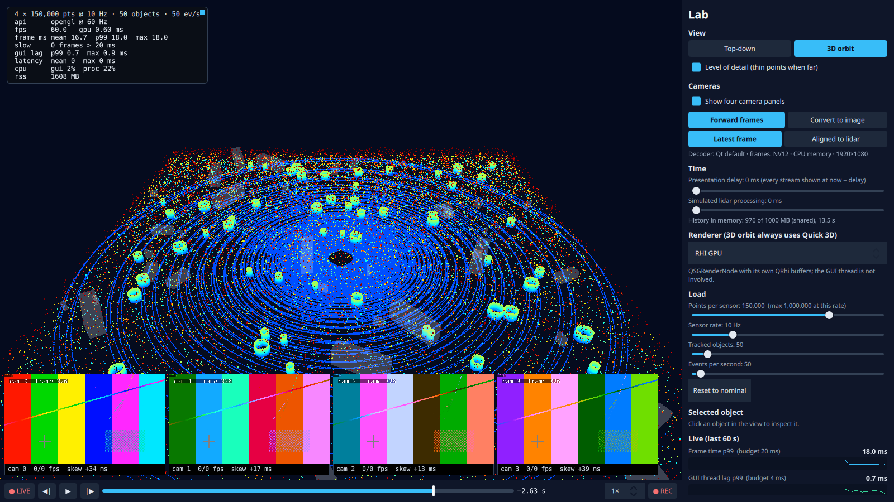
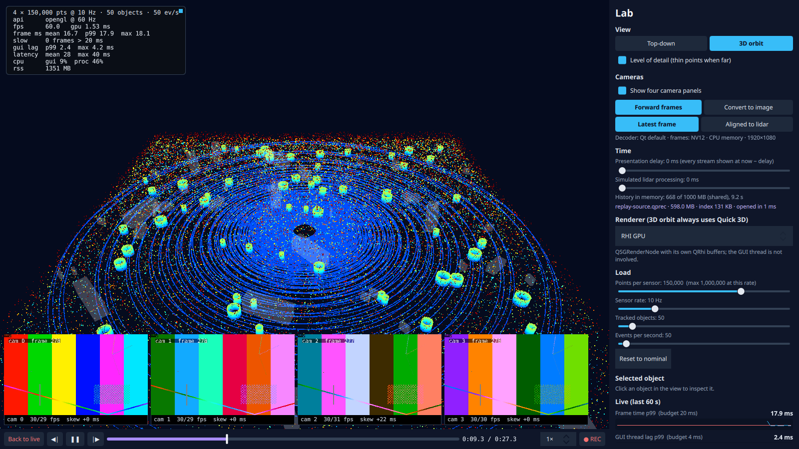

# Step 4: Timeline (pause, scrub, replay, record)

**What the user sees:** a timeline bar under the view. **● LIVE** is lit while you watch the present. Pause (Space), step one lidar frame (← →), drag the bar to scrub back through the last seconds, replay at ¼× to 4×, and press **● REC** (R) to record to disk. The button shows elapsed time, size and write rate. The lab panel lists recordings, and opening one turns the bar purple and replays it with the same controls. Cameras follow the timeline: paused, all four show the frame captured at that instant. Two new lab sliders: a **presentation delay** (every stream shown at *now − D*) and a **simulated lidar processing delay**.

**The design questions:** what is kept, in what shape, and how is time ordered?



## How much is there to keep?

> **Intermediate:** "Keep the last minute" sounds like a ring buffer. Done?
>
> **Senior:** Do the arithmetic first. Four lidars at 150k points and 10 Hz, 12 bytes a point, is 72 MB/s: 4.3 GB a minute. Tracks are 14 KB/s, events 2 KB/s. Cameras are 373 MB/s decoded but 3.3 MB/s as the H.264 they arrived in. So the question isn't "how do we keep everything?" It's "what shape is each stream kept in?"

| Stream (nominal) | Kept as | Rate |
|---|---|---|
| Lidar | the frame itself in memory; int16 + zstd on disk | 72 MB/s; 22 MB/s |
| Tracks, events | the same objects in memory; small records on disk | ~16 KB/s |
| Cameras | **not kept**: an index of capture time ↔ position in the source video | ~3 KB/s |

Cameras are replayed by seeking a second player on the same video, so the live camera keeps running (and recording) while you look at the past.

## Shape: what a lidar frame costs to keep

Measured per frame of 150k points (`app/tests/bench_codec.cpp` → [`codec.md`](../../results/step-04/codec.md)):

| Encoding | Bytes/point | vs float32 | Encode | Decode |
|---|---|---|---|---|
| float32 | 12 | 1× | 0.06 ms (a copy) | 0.08 ms |
| float32 + zstd 1 | 11.0 | 1.09× | 2.4 ms | 1.3 ms |
| int16, 1 cm steps | 6 | 2× | 0.18 ms | 0.37 ms |
| int16 + zstd 1 | 4.7 | 2.55× | 1.1 ms | 0.9 ms |
| **int16 planar + zstd 1** | **3.64** | **3.3×** | 1.9 ms | 0.95 ms |
| int16 + shuffle + zstd 9 | 3.56 | 3.4× | 8.6 ms | 1.0 ms |

> **Intermediate:** Why does compressing floats barely help?
>
> **Senior:** Noise. The low bits of a float32 coordinate are sensor noise, and noise doesn't compress. Quantising to 1 cm (the sensor is ±3–5 cm anyway) throws exactly those bits away and halves the size for free. "Planar" stores all low bytes and then all high bytes. The high bytes of nearby points are nearly identical, so zstd finds them. Level 9 buys 2% for four times the CPU.

The data is synthetic (uniform noise on a ring pattern). Real lidar compresses differently, usually better. The method holds; the ratio is this simulator's.

**In memory** the history keeps the frame itself: the frames were already immutable and shared (step 1), so keeping one is keeping a pointer. An int16 copy halves the bytes per second kept, but costs encoding on the simulator thread every frame.

## The trap: memory that looks free

| 60 s, nominal, cameras off | RSS at 10 s | RSS at end | CPU |
|---|---|---|---|
| Simulator reuses 4 clouds per sensor, no history | 237 MB | 237 MB | 16.7% |
| Every frame its own allocation, no history | 247 MB | 247 MB | 17.3% |
| Every frame its own allocation, 1 GB history (pointers) | 1,123 MB | 1,195 MB | 19.4% |
| Every frame its own allocation, 1 GB history (int16) | 687 MB | 1,199 MB | 21.4% |
| **Simulator reuses clouds, 1 GB history (pointers)** | **237 MB** | **237 MB** | 17.1% |

> **Intermediate:** The last row keeps a gigabyte of history in one megabyte?
>
> **Senior:** It keeps a gigabyte of *pointers to the same 16 clouds*. Steps 1–3 had a simulator that reused four clouds per sensor, which was fine while nobody kept a frame. The moment something keeps frames, that shortcut makes memory look free. A real sensor allocates every frame, so from this step on the simulator does too (`freshClouds`, default on). It costs 0.6 points of CPU, against the 1–3 I predicted.

- The budget holds: 1,000 MB of history adds ~950 MB of RSS and stops there. The pointer history fills in ~14 s; int16 holds ~28 s in the same budget.
- int16 costs 0.6 ms per frame on the simulator thread, the pointer history 0.002 ms. (It was 1.2 ms at first; see *The encoder lost its vectorisation* below.) The codec bench says 0.18 ms for the same work. The rest of the gap is unexplained: it isn't page faults (142 minor faults/s for both shapes); cold caches and the `powersave` governor on a thread that wakes 40 times a second are the suspects.
- **Decision:** pointers in memory (cheap, exact), int16 on disk (half the bytes before compression).

## On disk: a file that survives its writer

The `.qprec` file is a header (format version, JSON info: workload, cameras, encodings), then **chunks** (≤ 4 MB or 1 s; each with its record count, time range and two CRCs), then an **index** (one 24-byte entry per record, sorted by time) and a trailer pointing at the index.

> **Intermediate:** Why not one record after another and a seek table?
>
> **Senior:** Because the writer can die. If the process is killed, the index at the end never gets written. Each chunk checks itself (magic, header CRC, payload CRC), so a reader without an index scans the chunks and rebuilds it. A damaged chunk is skipped, and a damaged *header* is skipped by searching for the next valid one.

Tested (`app/tests/tst_recording.cpp`, 18 tests):
- files cut at 25 random points: every record in every complete chunk comes back, and nothing else;
- a flipped byte in a payload: that chunk is skipped, the rest recovered;
- a corrupted chunk header: resynchronised at the next chunk;
- 20,000 truncated or bit-flipped payloads fed to the decoders: no crash, no over-read.

The index is 0.02% of the file (55 KB for 251 MB), and opening a recording takes under a millisecond.

### Schema evolution

Every record carries a type, a version and its size. The rules, each with a test:
- **An incompatible change gets a new version.** int16 lidar (v2) and planar int16 (v3) live next to float32 (v1); readers decode all three.
- **A compatible change appends fields.** Tracks store their per-item stride, so a newer writer's extra field (test: 8 bytes per track) is skipped by today's reader.
- **Unknown types or versions are skipped and counted**, never fatal. A file from a newer *major* format is refused with a message.

## Time order

Records are written in the order they arrive, which is not the order they happened:

| Recording, 22 s | Records older than one already written | Worst |
|---|---|---|
| Lidar, tracks, events (one simulator thread) | 0 | 0 ms |
| Plus cameras, plus 150 ms lidar processing | **2,579** | **150 ms** |

So chunks overlap in time, and the file order means nothing. The index is sorted per stream at open, and the presenter keeps one cursor per stream, never one global "last time". A late sample is still shown if it's newer than what that stream last showed.

## Agreeing on "now": the presentation clock

The `Presenter` owns the playhead T, on its own thread:
- **live**: T = now − D;
- **playing**: T advances at the chosen rate;
- **paused**: T stays put.

Each stream shows its newest sample at or before T. With D = 0, live samples pass straight through, as before this step. A single lock covers "store and maybe pass through", so switching in and out of pass-through never shows a sample twice or drops one (tested with the delay toggled ten times while events flow).

Step 3 asked for this. Here is the answer, three runs each, four cameras, 3D view:

| Lidar processing | Presentation | \|skew\| p50 / p99 | Lidar latency p50 | Camera latency p50 | Frames late |
|---|---|---|---|---|---|
| 0 ms | latest frame | 9.0 / 25.9 ms | 26 ms | 25 ms | – |
| 0 ms | clock, D = 100 ms | 12.2 / 29.3 ms | 125 ms | 126 ms | 0.1 ms |
| **150 ms** | latest frame | **148.5** / 170.6 ms | 176 ms | 25 ms | – |
| **150 ms** | **clock, D = 200 ms** | **9.9** / 26.7 ms | 225 ms | 226 ms | 0.1 ms |
| 150 ms | clock, D = 120 ms (too short) | 26.8 / 51.9 ms | 176 ms | 146 ms | **31 ms** |

> **Intermediate:** So when the pipelines are equal, the clock only adds 100 ms?
>
> **Senior:** Yes, and that's the honest result. With equal pipelines "latest" is already aligned. When one pipeline is 150 ms slower, "latest" shows a camera 150 ms ahead of the lidar, which is a different moment of the world. The clock fixes it completely, and charges for it: every stream now waits for the slowest. And if D is shorter than the slowest pipeline, those frames are late by the difference: 31 ms late when D was 30 ms too short. D is a jitter buffer and must cover the slowest pipeline.

Same fps and GUI lag in every row (59.9 fps, p99 2.2–2.5 ms).

## Recording: the writer

The simulator thread hands frames (pointers) to a bounded queue and never waits. A writer thread encodes, compresses and writes. Over the queue budget (512 MB) a record is dropped and a *gap* record says so; replay can show the hole instead of hiding it.

| Recording (≈ 22 s, cameras off) | MB/s to disk | Writer, % of a core | Queue max | Dropped | Process CPU |
|---|---|---|---|---|---|
| not recording (step's baseline) | – | – | – | – | 17.3% |
| nominal, float32, uncompressed | 71.9 | 4.9% | 1.8 MB | 0 | 24.2% |
| nominal, int16 planar, uncompressed | 36.0 | 3.9% | 1.8 MB | 0 | 24.1% |
| **nominal, int16 planar + zstd 1** | **21.9** | 11.5% | 1.8 MB | 0 | 29.3% |
| peak, float32, uncompressed | 288 | 20.1% | 14.4 MB | 0 | 42.6% |
| peak, int16 planar + zstd 1 | 87.1 | 40.8% | 3.6 MB | 0 | 56.7% |

fps 60 in every row. GUI lag p99 is 2.2–2.6 ms, except 3.4 ms while writing 288 MB/s: the GUI thread never touches a recorded byte, but the page cache filling at that rate is felt.

### The writer was twice as slow as the bench

> **Intermediate:** The codec bench said 0.5 ms to encode a frame. The writer took 2.1.
>
> **Senior:** So I timed the two halves. Encoding was 0.97 ms; *appending the encoded frame to the chunk buffer* was 1.14 ms. Each frame was encoded into its own buffer and then copied into the chunk, and the chunk buffer was freed after every chunk (`QByteArray::clear()` releases memory), so every chunk regrew from nothing and faulted in fresh pages. Now frames are encoded straight into a chunk buffer that keeps its capacity: **1.0 ms per frame, and the writer's encode time halved.** The bench couldn't show this because it reused hot memory.

### The encoder lost its vectorisation

> **Intermediate:** Then the bench itself got slower?
>
> **Senior:** Yes. Re-running it after that change, int16 encoding had gone from 0.18 to 0.49 ms. To append into any buffer I'd replaced a typed `qint16` store with a 2-byte `memcpy` into a `char` buffer, and GCC stopped vectorising the loop. A typed store through an `aligned(1)` type (records start at any byte, so unaligned access must be legal) brought it back to 0.18 ms. The planar loop wrote two bytes to two places per value; quantising blocks of 1,024 into a local array and splitting the bytes in separate loops took it from 0.49 to 0.20 ms. In the app: history encode 1.39 → 0.6 ms, writer encode 1.0 → 0.55 ms. The bench was there, and the regression was visible only because I re-ran it.

### What a crash costs

- *At risk* (queued or in an unwritten chunk) peaked at 5.4 MB at nominal: about 1 s of lidar. Every chunk is handed to the OS when it's complete, so a killed process loses at most that.
- A power cut can also lose what the OS hasn't flushed. The file is synced only when recording stops (110–700 ms, longer after faster writing). Syncing every chunk would close that window and cost write latency. That trade-off is left as a setting for step 9.

## Layout: what a seek has to read

The first layout wrote records into chunks in arrival order, all streams mixed. Then a seek in a file took **197 ms warm, 577 ms cold** (page cache dropped), against 0.1 ms in memory.

> **Intermediate:** Reading one lidar frame per sensor is a few megabytes. Where do 197 ms go?
>
> **Senior:** In the event log. After a seek it shows the last 5 s of events: a few kilobytes, spread across every chunk of those 5 s, and every chunk is mostly lidar. To read 5 s of events we decompressed ~110 MB of lidar. The fix is to group records by how they're read: lidar in its own chunks, everything small (tracks, events, camera marks) in others. A test now checks that reading all events touches at most a fifth of the chunks it used to.

| Seek, paused, every 0.5 s | Presenter seek p50 / p99 | Lidar seek-to-photon p50 |
|---|---|---|
| in memory | 0.1 / 0.5 ms | 25 ms |
| file, mixed chunks, warm | 197 / 259 ms | 34 ms |
| file, mixed chunks, cold | 577 / 599 ms | 41 ms |
| **file, separate chunks, warm** | **15 / 21 ms** | 32 ms |
| **file, separate chunks, cold** | **65 / 84 ms** | 68 ms |

(Seek-to-photon is shorter than the seek itself for mixed chunks because lidar is read before the event backlog.)

## Replay



| Replay of a 25 s recording, four cameras | Presenter late p50 / p99 | Lidar latency (due → photon) p50 | Camera latency p50 | \|skew\| p50 | CPU |
|---|---|---|---|---|---|
| 1× | 0.1 / 0.2 ms | 27 ms | 23 ms | 10.9 ms | 46% |
| 4× | 0.1 / 1.5 ms | 21 ms | 21 ms | 2.8 ms | 93% |

Replay is as punctual as live (lidar 27 ms, cameras 23 ms, skew 11 ms, against live's 26, 25 and 9). It costs CPU because four replay decoders run next to the four live ones.

Pixel parity: a float32 replay differs from the live view by 126 pixels, exactly as two live runs differ from each other (124–128; every differing pixel is ±1 in one channel and toggles between two values). An int16 replay moves 0.3% of lit pixels by one pixel. A negative control checks that the replay shows the file and not the live scene ([`parity-exact.md`](../../results/step-04/parity-exact.md)).

### Three bugs the numbers found

1. **Replayed cameras ran about 90 ms behind the lidar** (|skew| p50 70 ms). The replay player started playing when its first frame was already due, then ran on its own clock. The fix is the step's own idea: the player runs 150 ms ahead, and each frame waits in a small buffer until the presentation clock says it is due. **Skew 70 → 9 ms.**
2. **At 4× the cameras showed nothing** (1,920 resyncs in 20 s, 140% CPU). Right after `setPosition()` the player still reports its old position, so the next drift check (marks arrive 120 times a second per camera at 4×) sought again, forever. Drift checks now wait 500 ms after a seek. **12 resyncs, 93% CPU, cameras on time.**
3. **One seek per run showed a frame seconds away from the target.** It was the first frame of a freshly created player, taken as the answer to a seek that player had dropped while still loading. Now a seek waits for the media to load, and only a frame within 50 ms of the target answers it. **Worst error is one frame period (−34 ms), as it should be.**

## Seeking cameras: the keyframe interval

Lidar seeks in memory take 0.1 ms. Camera seeks take 87 ms (p99 141 ms), and they decide how scrubbing feels. A controlled experiment (`experiments/05-video-seek`, [`video-seek.md`](../../results/step-04/video-seek.md)):

| Keyframe every | File size | 1 decoder p50 / p99 | 4 decoders p50 / p99 |
|---|---|---|---|
| 1 s | 24.3 MB | 21 / 48 ms | 54 / 105 ms |
| ⅓ s | 26.2 MB (+8%) | 14 / 38 ms | 27 / 44 ms |
| every frame | 46.5 MB (+91%) | 13 / 33 ms | 29 / 41 ms |

- A seek decodes from the previous keyframe: 13 ms at a keyframe, plus ~0.75 ms per frame after it.
- My prediction that 1 s keyframes wouldn't matter was wrong.
- In the app, a keyframe every ⅓ s takes camera seeks from 87 to **55 ms p50 (p99 141 → 71 ms)**.
- The keyframe interval is a recording decision, not a player setting: a camera system that will be scrubbed should record with short GOPs. The test videos are still 1 s GOPs (`GOP=10 scripts/make_videos.sh` makes the other set).

## Scrubbing

The scrub robot drags the playhead across the whole history and back (4 s per sweep), with four cameras on:

| | Before | After |
|---|---|---|
| Input-to-photon p99 | 33 ms | 33 ms |
| GUI lag p99 | 4.5 ms | **4.0 ms** (the budget) |
| Process CPU | 138% | 93% |
| Camera seeks issued | one per mouse move per camera | ~580 issued, ~3,440 skipped |

"After" is latest-wins for camera seeks: while a seek is in flight, newer targets replace each other, and only the last is sent. It is the same rule as the presenter's seek mailbox and step 1's frame mailbox. Lidar seeks didn't need it: all 1,006 completed in 0.09 ms each, before the next arrived. Scrubbing with four cameras is still at the edge of the GUI-lag budget. The remaining cost is decoding camera seeks; shorter GOPs (above) are the next lever.

## Memory over time

| 5-minute soak | RSS every 30 s (MB) |
|---|---|
| Live, 1 GB history, recording all the time (6.6 GB written, 0 dropped) | 1,500, 1,502, 1,503, 1,504, 1,506, 1,389, 1,393, 1,393, 1,394, 1,393 |
| Replaying a file in a loop, four live + four replay decoders | 1,867, 1,875, 1,866, 1,885, 1,877, 1,888, 1,901, 1,908, 1,910 |

The replay soak rose about 11 MB/min after warm-up: a leak, or a slow plateau? Five minutes couldn't say, so it ran for 15: growth slowed from 8.2 to 3.3 to 1.2 MB/min, and the last 10 minutes stayed between 1,902 and 1,919 MB. A plateau, not a leak. What the last 40 MB are isn't identified (the eight decoders' frame pools are the likely place; unproven). The recording soak's 115 MB drop at 150 s is memory given back to the OS; which allocation freed it is also unproven.

## Predictions against measurements

Predictions: [`results/step-04/predictions.md`](../../results/step-04/predictions.md). All tables: [`analysis.md`](../../results/step-04/analysis.md). "Before" numbers replaced by later runs: [`superseded.md`](../../results/step-04/superseded.md).

| Prediction | Measured | |
|---|---|---|
| Allocating every frame: +1–3% CPU | +0.6% | Cheaper |
| Latest frame, 150 ms lidar processing: \|skew\| ≈ 150 ms | 148.5 ms | Right |
| Shared clock D = 200: ≤ 15 ms p50, ≤ 35 ms p99 | 9.9 / 26.7 ms | Right |
| Lidar latency with D = 200: ≈ 225 ms | 225 ms | Right |
| 1 GB history: RSS +1 GB, then flat | +950 MB, flat | Right |
| History of shared pool clouds looks free | 237 MB, the same as no history | Right (the trap) |
| Ingest: pointer < 0.01 ms; int16 0.2–0.5 ms | 0.002 ms; 0.6 ms (1.2 before the vectorisation fix) | int16 slower |
| Seek in memory < 1 ms | 0.1 ms | Right |
| Scrub input-to-photon p99 ≤ 50 ms | 33 ms | Right |
| Recording 72 MB/s float32, short queue | 71.9 MB/s, queue ≤ 1.8 MB | Right |
| zstd 1 on float32: 1.1–1.3× | 1.09× | Right |
| zstd 1 on int16: 1.5–2× | 1.28× interleaved; 1.65× planar | Lower, until planar |
| File seek warm 2–5 ms; cold 10–30 ms | 15 / 65 ms (after the layout fix; 197 / 577 before) | **Wrong** |
| float32 replay pixel-identical | Identical within live's own ±1 noise | Right |
| int16 replay < 1 px error | 0.3% of lit pixels move 1 px | Right |
| Index < 0.1% of the file | 0.02% | Right |
| Cut files: every complete chunk recovered | Yes (25 random cuts) | Right |
| Camera seek 20–40 ms; 1 s keyframes don't matter | 87 ms with four cameras; keyframes dominate | **Wrong** |

## Decision

- **Memory:** keep the frames themselves, in a byte budget (1 GB ≈ 14 s at nominal).
- **Disk:** int16 planar + zstd 1, lidar and small records in separate chunks, an index at the end, recoverable without it.
- **Time:** one presentation clock for every stream, with one cursor per stream. Live passes straight through when the delay is 0. Set the delay above the slowest pipeline whenever pipelines differ.
- **Cameras:** keep the encoded video plus a time index, and follow by seeking, latest-wins.

| It would be the wrong choice if… | …then |
|---|---|
| History had to cover minutes, not seconds | int16 in memory (2×), or page the oldest seconds out to the recording file |
| Power loss must not lose a second of data | Sync each chunk; measure the write latency it adds |
| Real lidar data compressed differently | Re-run `bench_codec` on recorded data before choosing |
| Pipelines changed latency at run time | Adapt D from measured lateness (like a network jitter buffer) |
| Cameras were scrubbed constantly | Record with short GOPs, or keep decoded thumbnails |

## Run it

```bash
build/release/app/viewer --set view=orbit            # Space, ← →, L (live), R (record)
build/release/app/viewer --set lidarDelayMs=150 --set delayMs=200
python3 scripts/sweep.py step-04 && python3 scripts/step04_report.py
python3 scripts/parity.py replay
python3 scripts/video_seek.py
git checkout step-04
```
