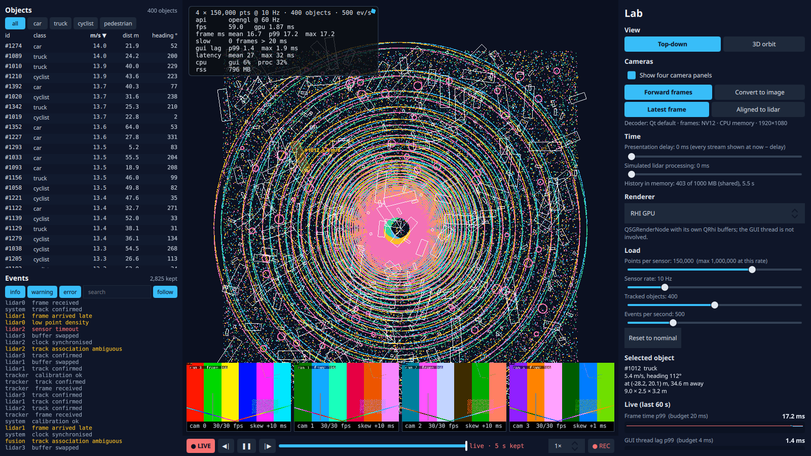

# Step 5: Object table and event log

**What the user sees:** a data panel on the left of the view.
- **Objects table:** one row per tracked object (id, class, speed, distance, heading). Click a header to sort (click again to reverse), filter by class, click a row to select the object (the same selection as clicking it in either view).
- **Event log** (moved from the lab panel, and taller): severity toggles, a search box, a *follow* switch, and a count of events kept and shown.

Both stay live: the table at 10 updates a second, the log at up to 2,000 events a second. The step's load range is 50–2,000 objects and 50–2,000 events/s.

**The design question:** how do changes reach the screen without rebuilding everything?



## The first implementation

Built from the models we had: the track model **resets** on every update, as it has since step 1, and the event model resets on every batch (20 a second) and keeps every event. Each view gets a `QSortFilterProxyModel` for sorting and filtering. All numbers below come from the same binary, with the strategy chosen by `--set` options.

| Top-down view + data panel, 10 Hz | Model update p50 | Rows created/s | fps | GUI lag p99 |
|---|---|---|---|---|
| 50 objects, reset | 5.3 ms | 390 | 60 | **6.8 ms** |
| 200 objects, reset | 11.9 ms | 390 | 60 | 15.6 ms |
| 800 objects, reset | 35.2 ms | 390 | 50 | 54 ms |
| 2,000 objects, reset | 139 ms | – | **0.4** | 8.6 s (the harness forced the exit) |

> **Intermediate:** 50 objects already breaks the 4 ms budget?
>
> **Senior:** Yes. A reset tells every view "forget everything", so every visible table row, every track box in the view and all their bindings are torn down and rebuilt ten times a second. 390 table rows created per second at *any* object count: the visible rows, ten times. And the view's track boxes, one QML item each, are rebuilt too. That's the part that grows with the object count.

The event log had the same problem with a twist:

| Event log, reset per batch | Batch p50 | Log rows created/s | GUI lag p99 | Memory |
|---|---|---|---|---|
| 50 events/s | 1.7 ms | 920 | 7.2 ms | |
| 2,000 events/s | 3.3 ms | 920 | 8.8 ms | |
| 2,000 events/s, after 3 minutes | **10.0 ms** | 920 | 18 ms | **+25 MB/min** (history off) |
| 2,000 events/s **with a search** | – | 25,875 | 3.1 s | 0.4 fps |

The batch cost grows with the *whole* log, not the visible rows: on a reset the proxy filters every row again (360,000 after three minutes). With a search active it does a string search on every row 20 times a second, and the app collapses.

## Diff updates: tell views what changed

The models now report changes the way the views can use them (`--set updates=diff`, now the default):
- **Tracks:** rows keep their identity (by track id). Changed rows are one `dataChanged` over the changed range, with only the roles that changed; new tracks are `rowsInserted`, gone tracks `rowsRemoved`.
- **Events:** each batch is one `rowsInserted` at the end. The log keeps the newest 10,000, and trims are one `rowsRemoved` at the front.

Tested with `QAbstractItemModelTester` over 300 random rounds of added, removed and moved tracks, and with trims and filters on the event log (`app/tests/tst_models.cpp`).

| Top-down view + data panel | Reset: GUI lag p99 | Diff: model update p50 | Diff: rows created/s | Diff: GUI lag p99 |
|---|---|---|---|---|
| 50 objects | 6.8 ms | 1.1 ms | 0 | 0.9 ms |
| 200 objects | 15.6 ms | 1.9 ms | 0 | 1.2 ms |
| 800 objects | 54 ms | 5.0 ms | 0 | **4.3 ms** |
| 2,000 objects | 8.6 s | 11.8 ms | 0 | **12.6 ms** |

| Event log, diff | Batch p50 | GUI lag p99 | Memory over 3 min (history off) |
|---|---|---|---|
| 2,000 events/s | 0.3 ms | 2.5 ms | flat (221 → 225 MB) |

No more rows created at all for the table, and the log's cost no longer depends on its length. But 2,000 objects still costs 12.6 ms of GUI lag.

## What the remaining 12 ms are

> **Intermediate:** Diff didn't fix the big case. Is it the table?
>
> **Senior:** Measure rather than guess. Hide the panel: GUI lag p99 at 2,000 objects 11.9 ms, the same. Switch to the 3D view, where the top-down boxes aren't drawn: 1.4 ms per update. So it's the top-down view's 2,000 QML items, each with a rectangle, a rotation and a text label. A `dataChanged` for 2,000 rows updates 2,000 delegates' bindings and re-lays out 2,000 strings, ten times a second. Diff stops the *rebuilding*; it can't stop an item per object from costing an item per object.

The fix is the one the lidar renderers made in step 1: no item per thing. `TrackOverlay` builds one scene graph subtree on the render thread, straight from the model's rows: every box outline in one line geometry, the selected box filled, and the labels in a text node. Labels are drawn for every object up to 200 and only the selected one above that; 2,000 overlapping labels at 7 px/m aren't readable anyway.

| Top-down, diff updates | Model update p50 | Overlay build (render thread) p50 | GUI lag p99 |
|---|---|---|---|
| 200 objects, an item per object | 2.0 ms | – | 1.3 ms |
| 200 objects, one node (200 labels) | 0.9 ms | **2.2 ms** | 2.3 ms |
| 800 objects, one node | 1.1 ms | 0.04 ms | 0.9 ms |
| **2,000 objects, one node** | **1.5 ms** | 0.1 ms | **1.0 ms** |

- At 200 objects the node isn't better: its 200 labels are rebuilt on every update while the GUI thread waits. **Text is the expensive part either way.** Caching each label until its text changes would cut that; speeds change every update, so not by much.
- The node draws boxes with 1-pixel lines, so 1.4% of the overlay's pixels differ from the antialiased QML rectangles. Side by side, the same boxes in the same places.

The 3D view had the same shape with bigger numbers (step 2's collapse at 2,000 objects):

| 3D view + data panel | Model update p50 | GUI lag p99 | fps |
|---|---|---|---|
| 2,000 boxes, `Repeater3D`, reset | 81 ms | 6.4 s | 4.3 |
| 2,000 boxes, `Repeater3D`, diff | 17.8 ms | 19.2 ms | 60 |
| **2,000 boxes, instanced, diff** | **1.4 ms** (instance table 0.3 ms) | **1.1 ms** | 60 |

The instanced version (`TrackInstancing`) is one `Model` with a per-instance table built from the same rows. Its picture matches the repeater's to within 1% colour tolerance (4 pixels differ). One oddity, unexplained: the `Repeater3D`+diff run at 800 boxes showed GUI lag p99 37.8 ms, worse than at 2,000 (single runs; that path is retired).

## Sorting

> **Intermediate:** Sorting 2,000 rows ten times a second must cost something.
>
> **Senior:** With nothing else in the way (3D view, instanced boxes): sorted by id, 1.5 ms per update; sorted by speed, which reorders the rows every update, 1.4 ms. No difference worth naming. The proxy re-sorts incrementally on `dataChanged`, and only ~25 rows are visible.

## Search: when diff is the wrong answer

With diff updates and the proxy filter, typing a search ("late", 1 in 8 events) over 10,000 events took **9.1 ms**. I'd predicted 2–5 ms.

- Not the string matching: case-insensitive search over 20,000 strings takes 1.5 ms (microbenchmark).
- Not `QVariant`: reading the records directly saved 0.3 ms.
- **The proxy reports a filter change as 1,251 separate `rowsRemoved` signals**, one per gap between matches (`tst_models`: 2.2 ms with no view attached; the list view handles each one).

The change is fragmented, and for a fragmented change one reset is cheaper. A generic proxy can't make that choice, so `EventFilterModel` keeps an index of matching rows. A filter change is one reset (1.5 ms in the test, one signal); new events are one insert per batch; trims one removal at the front.

The first measurement was worse: **93 ms per filter change, 45 fps.** With *follow* off it was 1.9 ms. The log's `onCountChanged: positionViewAtEnd()` ran *inside* the reset, while the view had no layout yet, and took ~75 ms. Deferring it with `Qt.callLater` fixed it:

| Search over 10,000 events at 2,000 events/s | Filter change p50 / p99 | GUI lag p99 |
|---|---|---|
| proxy (diff, delegate reuse) | 9.1 / 11.2 ms | 1.1 ms |
| index model, follow inside the reset | 93 / 250 ms | 3.9 ms (45 fps) |
| **index model, follow deferred** | **2.1 / 4.0 ms** | **0.9 ms** |

Both lessons point the same way: **say what changed, in the shape the receiver can use**. Usually that's fine-grained; for a filter change it's one reset. And a view's convenience call made in the middle of a model change can cost more than the change.

## Delegate reuse

With diff updates the log still created ~800 delegates a second at 2,000 events/s: each batch scrolls new rows into view. `ListView.reuseItems` keeps a pool:

| Event log, 2,000 events/s | Rows created/s | Rows reused/s | GUI lag p99 | GUI CPU |
|---|---|---|---|---|
| reuse off | 806 | 0 | 2.3 ms | 7.8% |
| **reuse on** | 0 | 805 | **1.4 ms** | 5.9% |

## Everything at once

2,000 objects, 2,000 events/s, four cameras, all the decisions above (30 s, two runs each):

| View | fps | Model update p50 | GUI lag p99 | Process CPU |
|---|---|---|---|---|
| top-down | 60 | 1.6 ms | **1.6 ms** | 29% |
| 3D | 60 | 1.4 ms | **1.7 ms** | 30% |

The first implementation at this load ran at 0.4 fps.

## Found along the way

1. **QML truthiness.** `--set dataPanel=0` didn't hide the panel: `--set` values are strings, and in QML `"0"` is true. The first "panel off" runs measured the panel on and were thrown away. `AppOptions.flag()` now converts the way C++ does, and the runs were repeated.
2. **A property named `id`.** The table's column widths had a property called `id`, which QML reserves. It compiled and ran, but `qmlformat` couldn't parse the file, and `check.sh` didn't notice because it only checked files git already tracked. It now checks untracked files too.
3. **A header binding that never ran.** Each header's `text` binding was replaced by the instance's `text: "id"`, so the sort arrow never showed. The title is now a separate property.
4. **Cameras on Vulkan print warnings** ("DmaBufEglContext: No rhi or non openGL based RHI", Qt Multimedia). It has been there since step 3, but no run had combined cameras and Vulkan until this step's parity check. The parity runs now turn cameras off (their strip was inside the compared region) and use 12k points, under the canvas renderer's cap. Every renderer passes on both APIs ([`parity.md`](../../results/step-05/parity.md)).

## Predictions against measurements

Predictions: [`results/step-05/predictions.md`](../../results/step-05/predictions.md). Tables: [`analysis.md`](../../results/step-05/analysis.md).

| Prediction | Measured | |
|---|---|---|
| Table, 2,000 objects, reset: GUI lag 6–15 ms | 8.6 s, 0.4 fps (the view's boxes, not only the table) | **Far worse** |
| ~1,250 delegates created per second | 390/s for the table (visible rows × 10); the view's boxes on top | Lower for the table |
| Unbounded log: 50–150 MB/min at 2,000 ev/s | 25 MB/min | Lower |
| Log resets over budget at 2,000 ev/s | 8.8 ms lag; and the reset cost grows with the log | Right, and worse over time |
| Diff: ~0 delegates created; lag ≤ 4 ms at 2,000 objects | 0 created; **12.6 ms** (the per-object QML items) | Half right |
| Re-sorting 2,000 rows < 1 ms | No measurable difference from not re-sorting | Right |
| Bounded log flat; < 0.2 ms per batch | Flat; 0.3 ms | Right |
| Search over 10,000 events: 2–5 ms | 9.1 ms (proxy), 2.1 ms (index model) | Wrong, then right |
| `Repeater3D` + diff at 2,000: 3–8 ms per update | 17.8 ms | Worse |
| Instancing < 1 ms per update | 0.3 ms instance table; 1.4 ms model update | Right |

## Decision

- Models report changes, not resets: identity by id, ranges of changed roles, inserts and removals at the ends.
- Bounded logs.
- No item per object where objects are many: one node for the top-down overlay, instancing in 3D.
- Labels have a budget (200).
- Delegate pools for scrolling lists.
- A filter change is one reset, through an index model. View calls go after model changes, not inside them.

| It would be the wrong choice if… | …then |
|---|---|
| Users needed every one of 2,000 labels | Label by zoom or on hover; cache text layouts per object |
| The log had to keep hours | Page old events to the recording (step 4's file) and keep only an index in memory |
| Rows changed position constantly (sorted by a live column at high rates) | Measure `layoutChanged` cost; consider sorting only on demand |
| Objects had rich per-object UI (buttons, editors) | Items are right for a few; a table with a pool for many |

## Run it

```bash
build/release/app/viewer --objects 2000 --events 2000                       # all the decisions
build/release/app/viewer --objects 800 --set updates=reset --set overlay=items   # the first version
python3 scripts/sweep.py step-05 && python3 scripts/step05_report.py
git checkout step-05
```
