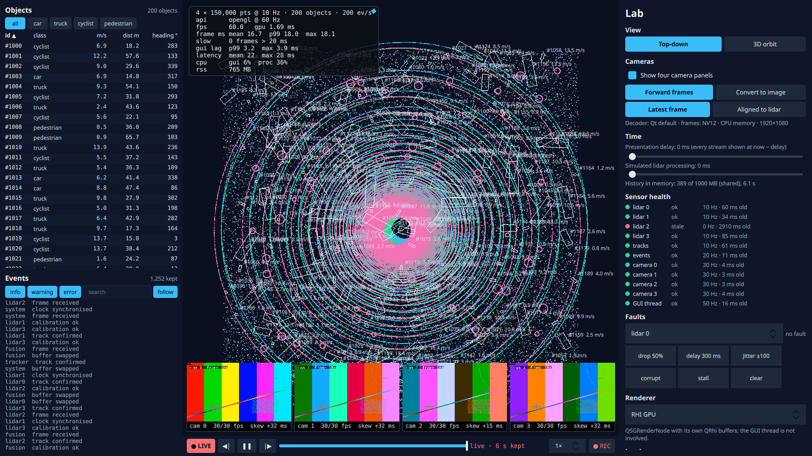

# Step 6: Sensor health and fault injection

**What the user sees:**
- **Sensor health** (lab panel): a row per stream (four lidars, tracks, events, four cameras, and the GUI thread itself) with a status light, the rate, the age of the newest sample, and what's lost, rejected or out of order.
- **Faults:** buttons inject them per stream (drop 50%, delay 300 ms, jitter, corrupt, stall) and can block the GUI thread for 300 ms every 2 s.
- **Health in the event log:** every change of status becomes an event, which is recorded with everything else.
- **Stale lidar is hidden:** a stalled lidar's points disappear instead of pretending to be current.

**The design questions:** what happens when parts fail, and who finds out?



## Who finds out

> **Intermediate:** Why a separate thread? The GUI could check the streams on a timer.
>
> **Senior:** Then a stalled GUI thread couldn't report its own stall, and it's one of the things that fails. The `HealthMonitor` evaluates every 20 ms on its own thread. The ingest paths report arrivals (sequence number, capture time) and rejections with a few atomic operations. The GUI thread is a stream too: a 20 ms heartbeat.

For each stream, over a 1 s window:

| Status | When | Priority |
|---|---|---|
| **stale** | nothing for 5 periods (500 ms for a 10 Hz lidar) | highest |
| **corrupt** | a sample rejected by validation | |
| **late** | nothing for 2 periods + 20 ms, or capture-to-arrival over the 100 ms budget | |
| **degraded** | over 10% missing (sequence gaps), or samples out of order | |
| ok | | |

A worse status applies at once. A better one must hold for 300 ms, so a stream doesn't flap.

## Detection, measured

Nominal load, four cameras. Each fault injected at 5 s and cleared at 10 s, three runs each:

| Fault | Detected after | Then | Recovered after clearing | fps | GUI lag p99 |
|---|---|---|---|---|---|
| lidar 2 stall | 148–224 ms (late) | stale at 452 ms | 1.33–1.42 s | 60 | 3.0 ms |
| lidar 2 delay +300 ms | 166–195 ms (late) | | 1.56–1.59 s | 60 | 2.9 ms |
| lidar 2 drops 50% | 338–384 ms (degraded) | late at 467 ms | 1.06–1.12 s | 60 | 2.9 ms |
| lidar 2 jitter (0–200 ms) | 170–174 ms (late) | degraded (out of order) at 2.2 s | 1.21–1.47 s | 60 | 2.9 ms |
| lidar 2 corrupt | 42–70 ms | | 1.23–1.30 s | 60 | 3.0 ms |
| tracks corrupt | 30–89 ms | | 1.25–1.31 s | 60 | 3.0 ms |
| tracks stall | 218–233 ms (late) | stale at 511 ms | 1.35–1.41 s | 60 | 2.6 ms |
| GUI thread blocked 300 ms | 72–74 ms (late) | stale at 114 ms | (recovers between blocks) | 55.7 | 3.0 ms |

- **Stalls show as "late" first**, then "stale". The first warning comes at about two periods, not five.
- **Recovery takes the window**: about 1 s for the 1 s window to forget the fault, plus the 300 ms hold. A shorter window recovers faster but sees less.
- **The rest of the app doesn't notice** any fault but the GUI block: 60 fps, GUI lag p99 within budget. The streams were already isolated (step 1's per-sensor mailbox).
- **False alarms: none.** Five minutes at nominal and two minutes at peak (4 × 300k at 20 Hz, 800 objects, 2,000 events/s), no status change on any stream.

### Blocking the GUI thread: the watcher sees it, and so do the cameras

The health thread saw the GUI heartbeat stop within 72–74 ms. But all four camera streams went late and stale with it, in every block (9 times each in 3 runs).

> **Intermediate:** The cameras didn't fail.
>
> **Senior:** No, but their arrivals are *observed* on the GUI thread: the decoder's frames are queued to the GUI thread, and that's where we note them. Block the GUI and the cameras look dead. The health of a stream is only as independent as the thread that observes it. The fix is to note camera arrivals on the decoder thread (step 3's offset estimation already runs there). It's left for now: it's honest that the GUI is the bottleneck, but the alarm points at the wrong component.

## Corrupt data lies; it rarely crashes

Corrupt lidar frames (1% NaN, 0.1% at 10⁶ m) and corrupt tracks (one NaN position), **without validation**:
- **No crash, no stderr, 60 fps, and health stays green.** Nothing finds out.
- NaN points are dropped by the GPU; the spikes are off screen.
- A NaN track draws nothing and can't be picked, while the table still counts it: 200 objects listed, 199 drawn.
- The table's sort survives: one NaN row among 200 sorts to the end with every other row in order (`tst_models`). I'd predicted it would break the order; it doesn't.
- **The recording lied.** int16 encoding clamped 10⁶ m to 327.67 m, a plausible-looking point, and turned NaN into 0 through undefined behaviour (a float NaN converted to an integer).

Two fixes, at two boundaries:
1. **Validation at ingest.** Every lidar frame is checked (finite, within 1,000 m) and rejected whole if bad; bad tracks are removed and the rest kept. Rejections are counted, which is how health sees corruption (42–89 ms). Cost: **0.26 ms per frame at nominal, 0.69 ms at peak** (300k points), on the simulator thread.
2. **The codec keeps bad as bad.** A value int16 can't hold is stored as a reserved code (−32768, never a quantised value) and read back as NaN. A test checks both cases. The safety costs a second read of each frame, **0.18 ms**: encoding went from 0.18 to 0.35 ms per frame ([`codec.md`](../../results/step-06/codec.md)).

> **Intermediate:** 0.18 ms for a check that never fires?
>
> **Senior:** I tried to fold the check into the encoding loop. Three variants were all slower, up to 3×: GCC's vectoriser report showed it won't vectorise a `bool` reduction, or an accumulator passed by reference. A separate counting pass vectorises, and it's 0.7% of a core at nominal. The same lesson fixed the validator: counting into an `int` instead of `&=` into a `bool`.

## Arrival order is not capture order

With jitter, lidar 2's frames arrive out of order (the recording saw 651 records out of order, the worst 201 ms late). Live pass-through hands frames to the renderers *as they arrive*:

| Lidar 2 jittered, live view | Frames shown older than the previous one | Older frames not shown |
|---|---|---|
| show whatever arrived last (`keepOrder=0`) | **1.2 per second** | 0 |
| never older than what is shown (default) | 0 | 1.2 per second |

> **Intermediate:** So the view went backwards in time, a little over once a second, and nothing measured it?
>
> **Senior:** Nothing *could* measure it until the health monitor counted sequence numbers going backwards. The presenter's delayed and replay modes were already safe: they keep a cursor per stream and only move it forward (step 4). Pass-through didn't. Now it drops a frame older than the newest shown for its sensor; history and recordings still keep it, in capture order.

My first jitter fault never reordered anything: a negative delay was clamped to zero, so delays ran 0–100 ms and two frames 100 ms apart could never swap. Jitter now spreads delays over 0–200 ms.

## Found along the way

1. **"Other alarms" were the fault itself.** The first count blamed a stalled stream for going from *late* to *stale*, and a stream that was just un-stalled for its sequence gap. A fault is now attributed to its stream until that stream is ok again.
2. **The first GUI-block detection read 2.1 s.** The block started 2 s after injection; it now starts at once.
3. **A status called "dropping" also meant "out of order".** Renamed *degraded*, with the reason in the event text.

## Predictions against measurements

Predictions: [`results/step-06/predictions.md`](../../results/step-06/predictions.md). Tables: [`analysis.md`](../../results/step-06/analysis.md).

| Prediction | Measured | |
|---|---|---|
| Corrupt lidar without validation: no crash; recording clamps or garbles | Exactly that (clamp to 327.67 m; NaN → 0 by undefined behaviour) | Right |
| Corrupt tracks: no crash; table sorts unpredictably | No crash; table sort intact (NaN sorts last) | Half right |
| Validation 0.1–0.3 ms per frame | 0.26 ms (nominal), 0.69 ms (peak, 300k points) | Right |
| Stall detection ~500 ms | Late at ~180 ms, stale at ~450 ms | Earlier warning than predicted |
| Delay detection within one period | 166–195 ms (two periods: the "late" threshold) | Slower |
| Drop detection within 1 s | 338–384 ms | Right |
| Corrupt detection on the first sample | 30–89 ms (the next 20 ms tick after the first corrupt sample) | Right |
| GUI block: only another thread notices, within ~50 ms | 72–74 ms, from the health thread; cameras falsely flagged with it | Right, plus a surprise |
| No false alarms at nominal in 5 min | None (and none at peak in 2 min) | Right |
| Rest of the app unaffected by one bad stream | 60 fps, GUI lag p99 ≤ 3 ms | Right |
| Jitter: the presenter shows only the newest | True for the presenter; **pass-through showed older frames 1.2 times a second** | Wrong for live |

## Decision

- **Validate at ingest**: reject whole lidar frames, remove bad tracks, count both.
- **Watch from a thread of its own**, with the GUI thread as one of the watched streams.
- **Thresholds in periods**, not milliseconds, so they follow the sensor rate. Worse statuses apply at once, better ones after 300 ms.
- **Hide stale data** rather than show it as current.
- **Never let the view go back in time.**
- **Codecs must not depend on validation upstream.**

| It would be the wrong choice if… | …then |
|---|---|
| A frame with a few bad points still had to be shown | Repair (drop bad points) instead of rejecting; count repaired points |
| Faults must be detected in under 100 ms | Shorter windows and a heartbeat from the sensor itself (absence of data is slow to prove) |
| The GUI thread is routinely busy | Observe every stream off the GUI thread (cameras today aren't) |
| Out-of-order data is normal for a stream (e.g. over UDP) | A per-stream reorder buffer (step 4's presentation delay) instead of dropping |

## Run it

```bash
build/release/app/viewer                                   # lab panel: Sensor health, Faults
build/release/app/viewer --set fault=2:stall@5 --set faultClear=10
build/release/app/viewer --set fault=2:jitter100@3 --set keepOrder=0   # the view goes backwards
python3 scripts/sweep.py step-06 && python3 scripts/step06_report.py
git checkout step-06
```
