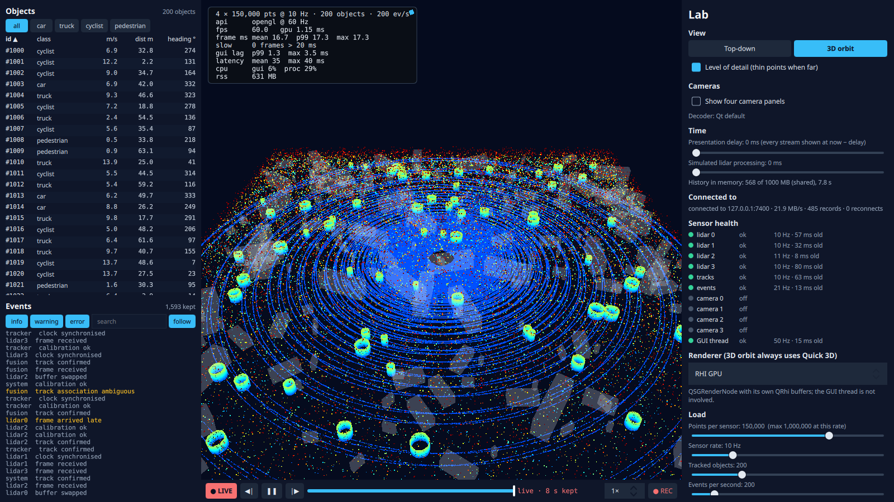

# Step 7: A second viewer in another process

**What the user sees:**
- **Serving:** `viewer --set serve=7400` shares its live streams. Its lab panel lists the connected viewers with their send rate, backlog, replaced frames and dropped events.
- **Connecting:** `viewer --no-sim --set connect=host:7400` shows them: lidar, tracks, events (including the first viewer's health events), in either view, with its own timeline, recording and health panel.
- **Reconnecting:** if the first viewer goes away, the second shows its streams stale and reconnects when it's back.

Cameras stay local: streaming video means re-encoding it, which this step doesn't do.

**The design questions:** one process or several, what crosses the boundary, and what happens when the receiver can't keep up?



## What crosses the boundary

> **Intermediate:** A new protocol for this?
>
> **Senior:** We already have one. Step 4's record — type, version, stream, capture time, size, payload — is exactly what a stream needs, and its versioning rules (skip unknown types, ignore appended fields) are what lets two viewers of different versions talk. The wire is a hello (format version and JSON info) followed by records. Lidar travels as planar int16, optionally zstd-compressed per record (a flag in the record header). The receiver feeds what arrives into its timeline, exactly like the simulator does, so history, recording and health work without knowing where data came from.

Each lidar frame is **encoded once**, on the server's own thread, and the same bytes go to every client. Tested: the parser takes the stream one byte at a time, rejects an HTTP request and an absurd record size, and a loopback server and client deliver every record in order (`app/tests/tst_wire.cpp`).

All measurements below: nominal load (4 × 150k points at 10 Hz, 200 objects, 200 events/s), one machine, two runs each. Capture time comes from the simulator in the serving process and is compared with the photon in each process: one monotonic clock on one machine. Across machines this needs clock-offset estimation, as for the cameras in step 3.

| | Bandwidth | Server encode per frame | Latency capture → photon, p50 / p99 | Server CPU |
|---|---|---|---|---|
| The serving viewer itself | – | – | 25.0 / 33.5 ms | 30% |
| Client, int16 uncompressed | 36.1 MB/s | 0.73 ms | **26.8** / 37.2 ms | 30% |
| Client, int16 + zstd 1 | 21.9 MB/s | 2.93 ms | **29.9** / 40.2 ms | 37% |

> **Intermediate:** So the second process costs 2–5 ms. Compress or not?
>
> **Senior:** On loopback, compression only costs: 3 ms of latency and 7 points of server CPU, to save bandwidth we don't need. On gigabit Ethernet 36 MB/s still fits; on Wi-Fi or a shared uplink it may not. It's a setting (`wireZstd`), and the default (compressed) is the safe one for a network.

| Clients | Server CPU | Each client's latency p50 | Lidar updates/s per client |
|---|---|---|---|
| 1 | 36% | 30.0 ms | 40 |
| 2 | 38% | 29.8 ms | 40 |
| 4 | 48% | 30.6–31.3 ms | 40 |

Encoding once makes each extra client cost about 2 points of server CPU, mostly socket copies. Four is where the *machine* runs short: five windows rendering at 60 fps on one integrated GPU take every process's GUI lag to 4.3–4.8 ms.

## A client that can't keep up

One client reads at 10 MB/s while 22 MB/s is offered (a slow link, or a slow machine). A second, normal client is connected at the same time.

**First implementation: write every record to every socket.**

| 30 s | Server backlog for the slow client | Slow client: latency p50 / p99 | Fast client: latency p50 |
|---|---|---|---|
| write everything | **367 MB** and growing (server RSS +221 MB above the others) | **9.4 s / 16.8 s** | 29.2 ms |

> **Intermediate:** The slow client is nine seconds behind and the server is fine?
>
> **Senior:** The server is *not* fine; it just hasn't run out yet. `QTcpSocket::write` never blocks and never refuses: what the peer can't take waits in the socket's buffer, without limit. The slow client shows a world from 9 s ago, then 16 s, then minutes, and the server pays for every byte of that history in memory. The fast client doesn't notice, because each socket has its own buffer. Isolation was free; boundedness wasn't.

**Latest-wins with the socket backlog as the limit.** Per client:
- the newest record per stream waits, and replaces the one before it if that one hasn't been sent;
- events wait in a bounded queue (10 s), and the oldest is dropped and counted beyond that;
- records are written only while the socket's backlog is under 1 MB, so TCP's own flow control becomes the client's credit;
- the oldest waiting capture goes first, so no sensor starves.

| 30 s | Server backlog | Server RSS | Slow client latency p50 / p99 | Slow client lidar updates/s |
|---|---|---|---|---|
| write everything | 367 MB, growing | +221 MB | 9.4 s / 16.8 s | 15.9 |
| **latest-wins** | **1.1 MB** | flat | **655 / 689 ms** | 16.3 |
| latest-wins, 256 KB limit and 256 KB kernel buffers | 0.8 MB | flat | **330 / 365 ms** | 16.6 |

> **Intermediate:** Bounded, but 655 ms isn't "latest".
>
> **Senior:** Because our 1 MB isn't the only queue. The kernel keeps send and receive buffers of its own, autotuned to several megabytes on loopback, and at 8.75 MB/s every megabyte queued is 114 ms. Shrinking our limit and both kernel buffers to 256 KB halved the latency. About 2.9 MB still waits somewhere I haven't identified. One frame is 0.55 MB and takes 63 ms to cross at that rate, so this client can't get below ~70 ms however small the buffers. **Every buffer between producer and consumer is a queue, and a queue in front of a slow consumer is latency.**

The slow client's own health panel shows the truth: its lidars get about 4 updates a second each, and they go *late* and *stale* in turns. The receiving side is where a degraded link is visible. The fast client and the serving viewer are unaffected in every run.

## When the server goes away

The serving viewer exits after 6 s; a new one starts at 12 s; the client keeps running:
- the client's health shows every stream **late, then stale**: one alarm each, as it should;
- it **reconnects by itself** (backoff 250 ms doubling to 2 s), and the streams return to ok.

The first version also raised *degraded* after reconnecting: the new server's sequence numbers restart at 0, which looks like samples arriving out of order. A new session has to say so: the client now tells the health monitor on every hello, and it starts counting afresh. **Sequence numbers only mean something within a session.**

## Predictions against measurements

Predictions: [`results/step-07/predictions.md`](../../results/step-07/predictions.md). Tables: [`analysis.md`](../../results/step-07/analysis.md).

| Prediction | Measured | |
|---|---|---|
| 72 / 36 / 22 MB/s for float32 / int16 / int16 + zstd | 36.1 (int16), 21.9 (zstd); float32 not sent | Right |
| Second process adds 5–15 ms | 1.8 ms (uncompressed), 4.9 ms (zstd) | Less |
| +1–3% server CPU per extra client (encode once) | ~2 points per client | Right |
| Slow client, write everything: unbounded backlog, ~12 MB/s; tens of seconds behind after a minute | 367 MB in 30 s (~13 MB/s); 9.4 s p50, 16.8 s p99 after 30 s | Right |
| Latest-wins: flat memory, a few hundred ms | Flat; 655 ms, 330 ms with small kernel buffers | Slower than guessed: kernel buffers |
| Other clients unaffected | Unaffected in both designs | Right |
| Reconnect with backoff; stale then ok | Yes, once a new session resets sequence tracking | Right, after a fix |

## Decision

- **Several processes, one protocol:** the recording's record format, versioned, over TCP.
- **Encode once** per sample for all clients.
- **Per client, latest-wins** for state streams (lidar, tracks), bounded queues with counted drops for events, and the socket backlog as the credit.
- **Small kernel buffers** where latency matters more than throughput.
- **A hello starts a session,** and receivers reset what depends on sequence numbers.

| It would be the wrong choice if… | …then |
|---|---|
| A client must receive every lidar frame (a recorder) | A separate mode: block or disconnect when it falls behind, never silently drop |
| Clients are on other machines | Clock offset from the stream (step 3's minimum-delay method); authentication and encryption (step 8's trust boundary) |
| Many clients on one link | Multicast or a relay; encode once per quality level |
| Cameras must be remote | Forward the encoded H.264, not frames; the time index from step 4 maps it |

## Run it

```bash
build/release/app/viewer --set serve=7400
build/release/app/viewer --no-sim --set connect=127.0.0.1:7400 --set cameras=0
build/release/app/viewer --no-sim --set connect=127.0.0.1:7400 --set readMbps=10     # a slow client
python3 scripts/twoproc.py && python3 scripts/step07_report.py
git checkout step-07
```
