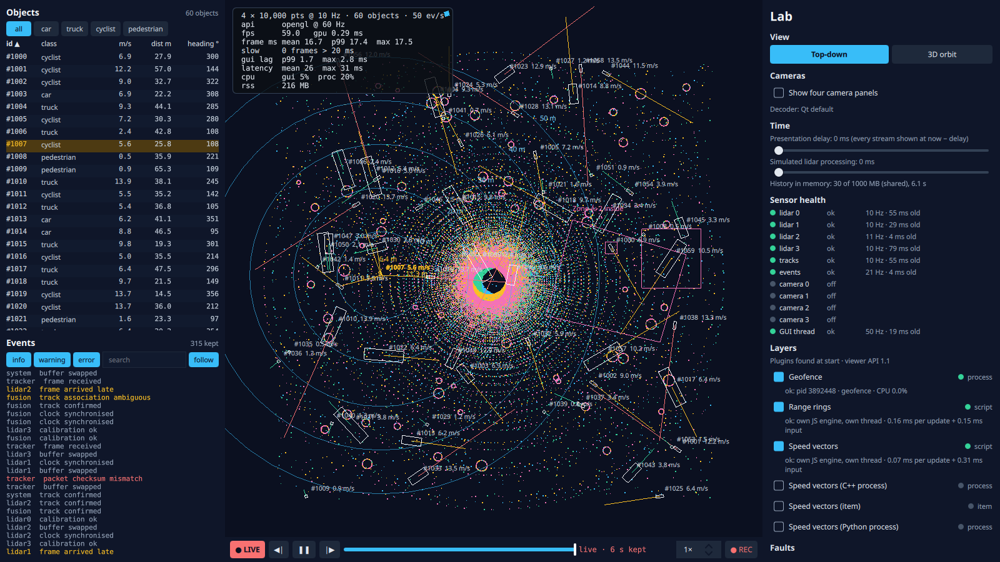

# Step 8: overlay layers from plugins

**What the user sees:** a "Layers" section in the lab panel, listing every layer found in `plugins/` at start. Each layer shows:
- an on/off switch;
- its kind;
- a status (ok, slow, suspended, stopped, crashed, not responding, failed, refused) with the reason;
- what it costs.

The layers that ship:
- **speed vectors:** where each object will be in 2 s;
- **range rings:** around the selected object, with the distance to its three nearest neighbours;
- **a geofence:** a zone, and the objects inside it, written in Python.

Layers are off until the user turns them on.

**The design question:** how does the system change without breaking? What may a plugin touch, how is it versioned, and what happens when it misbehaves?



Plugin authors' guide: [`plugins/README.md`](../../plugins/README.md).

## Three ways in

> **Intermediate:** A plugin is a QML file we load. What's to design?
>
> **Senior:** Three things you can't take back once people write plugins:
> - **Shape:** what a plugin is given and what it returns.
> - **Place:** where its code runs.
> - **Version:** how the contract changes later.
>
> We built three answers and measured them against each other with the same layer, speed vectors, one line per object:
> - **Item plugin:** a QML item in the viewer's own engine. It gets the tracks model and the scale, and draws however it likes. This is what "QML plugin" means by default.
> - **Script plugin:** `update(input, draw)`. The tracks come in as plain data and drawing commands go out; the viewer draws them. Its engine is its own.
> - **Process plugin:** any executable. It reads tracks records on stdin and writes overlay records on stdout, using step 7's wire.

The overlay is the same data whichever way it was made: segments and labels in world metres. One scene-graph node per layer draws it (`LayerOverlay`), at 0.02 ms per update for 2,000 lines.

## What a layer costs

Nominal lidar, 200 events/s, cameras off, two runs each ([`analysis.md`](../../results/step-08/analysis.md)). *Work* is the layer's own cost per update on its thread, in ms: converting the input, then `update()`. *Latency* is from the tracks being shown to the overlay reaching the GUI thread.

| 2,000 objects | GUI lag p99 | GUI CPU | Work per update | Latency p50 / p99 |
|---|---|---|---|---|
| no layer | 1.43 ms | 6.4% | – | – |
| **item** | **8.74 ms** | 13.6% | not measurable | – |
| script, GUI thread (JS module / QML object) | **4.24 / 4.61 ms** | 11.0% | 2.01 + 0.78 | 2.8 / 3.9 ms |
| script, own thread (JS module / QML object) | 1.92 / 2.11 ms | 8.0% | 2.28 + 0.78 | 3.2 / 4.9 ms |
| process, Python | 1.61 ms | 7.1% | plugin CPU 2.3% | 2.6 / 3.9 ms |
| process, Python in `bwrap` | 1.77 ms | 7.4% | plugin CPU 2.5% | 2.9 / 4.3 ms |
| process, C++ | 1.74 ms | 7.4% | plugin CPU 0.3% | **0.7 / 1.7 ms** |

At 200 objects every kind stays within 0.5 ms of no layer.

> **Intermediate:** The item plugin is over the 4 ms budget: 2,000 delegates, as in step 5. But the script on the GUI thread is over too, and it only draws lines.
>
> **Senior:** Look at where its time goes: 2.0 ms converting 2,000 tracks into JavaScript objects, 0.8 ms in the plugin's own code. The API's input shape costs more than the plugin. Moved to its own thread, that cost leaves the GUI.
>
> **Intermediate:** And the C++ process is the fastest of all, across a process boundary?
>
> **Senior:** Its input is the tracks record the viewer already encodes once for every process layer: 58 KB written to a pipe. It reads it with `memcpy`. A process boundary is a copy of bytes, and bytes are cheap. Turning the data into a scripting language's objects is the expensive copy. Python pays it too, but in its own process, on another core. **What crosses a boundary, and in what shape, matters more than which boundary it is.**

## When a plugin misbehaves

Lab plugins in `plugins-lab/` (`--set labPlugins=1`) misbehave on purpose after 60 updates; 200 objects; two runs each.

| Plugin | What the viewer did | GUI lag max |
|---|---|---|
| **item, endless loop** | **Nothing it could do: the viewer hung for good** (no frame for the last 11.8 s of 15; the harness forced the exit) | ∞ |
| script on the GUI thread, endless loop | Watchdog interrupted `update()` after 101–105 ms; layer *stopped* | 119 ms, once |
| script on its own thread, endless loop | Same, and the GUI never waited | 11 ms |
| script on the GUI thread, 30 ms per update | *Suspended* after 3 updates over the 4 ms budget | 4.4 ms |
| script on its own thread, 30 ms per update | Nothing needed: it keeps up (30 < 100 ms) | 13 ms |
| process that crashes | Restarted in 394 ms (250 ms backoff + start-up); *failed* after 5 crashes in a minute | 11 ms |
| process that stops answering | Killed after 2 s of silence, restarted | 9 ms |
| process that writes garbage | Protocol error on the first bad record; killed, restarted | 10 ms |

> **Intermediate:** How does the viewer stop a JavaScript loop?
>
> **Senior:** `QJSEngine::setInterrupted()` is thread-safe. A watchdog thread checks every 5 ms how long each script engine has been inside `update()`. Past 100 ms it interrupts that engine, and the call returns an error. That only works because the plugin has an engine of its own, and the viewer calls into it at a point it controls and times. The item plugin runs inside the viewer's engine, in bindings and handlers the viewer never calls. There is nothing to time and nothing to interrupt without interrupting the viewer.

### A plugin that floods

The flood plugin answers as fast as it can write, with 5,000 segments per answer.

| 15 s of flood | Overlays handed to the GUI thread | GUI CPU | Process CPU |
|---|---|---|---|
| (no layer) | – | 6.2% | 26% |
| First implementation: decode every overlay, hand every one over | **19,524/s** | 19.8% | 142% |
| Decode only the newest of each read; at most one hand-over per 8 ms | 124/s | 7.6% | **131%** |
| Enforce the contract: one answer per input | cut off in 4 ms; *failed* after 5 tries at 3.9 s | 6.2% | 27% |

> **Intermediate:** The second row fixes the GUI. Why is the process still at 131%?
>
> **Senior:** Because reading is work, and the plugin decides how much of it there is. A plugin can write as fast as we can read. Latest-wins protects the consumer of the data; it doesn't protect the reader from the producer. On the network in step 7 we stopped reading and let TCP push back. `QProcess` reads whatever arrives, so here the bound has to be a rule: one answer per input. Break it and you are cut off.
>
> A side note on the way there: a mailbox (keep the newest, one hand-over in flight) changed nothing. The GUI thread emptied it as fast as it filled. Coalescing only happens if something waits, so the hand-overs had to be paced.

## What a plugin can reach

`scripts/step08_trust.py` ([`trust.md`](../../results/step-08/trust.md)): each "curious" lab plugin tries the same things against a page served on 127.0.0.1.

| | Item (viewer's engine) | Script, QML entry (own QML engine) | Script, JS module (own JS engine) | Process | Process in `bwrap` |
|---|---|---|---|---|---|
| Viewer's singletons | **Read them, and paused the timeline** | `import Viewer` resolves; the singletons are null | `Qt` is not defined | – | – |
| Viewer's options (`AppOptions`) | yes | **yes, the live object** | no | – | – |
| Network | read the page | blocked (by our network factory) | no `XMLHttpRequest` | connected | refused (no network) |
| Local files | – | blocked (Qt's default; one environment variable re-enables it) | no API | **read** | **read** (`/` is mounted read-only) |
| Home directory | – | – | – | 94 entries | empty |

> **Intermediate:** We gave script plugins their own QML engine, an import filter and a network factory that refuses everything. And they still reached the options?
>
> **Senior:** The filter only sees modules that are loaded from a directory. Ours are compiled into the binary, and so is `AppOptions`, a singleton that hands every engine the same C++ object. You can't make a QML engine see less by filtering it; there is always one more door. The JS engine starts the other way round. It has nothing but the language, `console`, and the two objects we pass to `update()`. **Deny by default is a design; allow and then filter is a hope.** So a script's entry is a `.mjs` module by default. A QML entry still works, and the guide says what it can reach.
>
> **Intermediate:** And a process can read my files.
>
> **Senior:** A process is a boundary for failures, not for trust: it runs as you. The OS can make it a trust boundary. In `bwrap` it has no network and no home. It still reads `/etc`, because we mount `/` read-only. A tighter list of mounts is the next turn of that screw. The sandbox cost +0.3 ms latency and +0.2 points of CPU.

## Versioning

- **The manifest:** it names the API a plugin was written for (`"api": "1.1"`). The viewer offers 1.1.
- **The gate:** a plugin needing a newer minor or another major is *refused*, with the reason, at start. That happens before any of its code runs.
- **What changed from 1.0 to 1.1:**
  - scripts gained `input.selectedId`, which range rings use;
  - processes gained a Selection record.
- **Old plugins keep working:** the 1.0 plugins (speed vectors, geofence) did not change. A 1.0 Python plugin is tested against a record type it never heard of, and against tracks with 11 bytes per item it doesn't know: it skips both and answers correctly (`tst_plugins: pythonPluginSkipsWhatItDoesNotKnow`).
- **Additive changes only:** they need nothing from old plugins, because readers skip what they don't know and items carry their size. Removing or changing a field is a new major version, and every plugin is refused until it is updated.

## Predictions against measurements

Predictions: [`results/step-08/predictions.md`](../../results/step-08/predictions.md).

| Prediction | Measured | |
|---|---|---|
| Item plugin, 2,000 objects: GUI lag p99 8–15 ms | 8.74 ms | Right |
| Script on the GUI thread: +2–4 ms | +2.8 ms; mostly converting the input, not the plugin | Right, for a reason I didn't expect |
| Own thread or process: within 0.5 ms of no layer | +0.2 to +0.5 ms; +0.7 ms for the QML object on its own thread | Right, nearly |
| Latency: own thread 1–3 ms, C++ 1–3, Python 5–15 | 3.2, 0.7, 2.6 ms | Python and C++ faster; in-process JS slower |
| Endless loop: item hangs; GUI thread one 100 ms stall; own thread none | Exactly that (101–105 ms) | Right |
| 30 ms per update: suspended on the GUI thread; fine on its own | Yes | Right |
| Crash: restarted within 0.5 s; given up after 5 a minute | 394 ms; yes | Right |
| Hang noticed after 2 s; garbage on the first record | Yes; yes | Right |
| Flood: GUI unaffected by latest-wins; reader busy | First version handed 19,524 overlays/s to the GUI; reader busy until the contract was enforced | Wrong first, then right |
| Item can do anything; script in its own engine can't reach the viewer | Item: yes. Own QML engine: still reached the options | **Wrong**: only a plain JS engine kept it out |
| Process reads anything; in `bwrap`, neither files nor network | No network, no home; system files still readable | Partly |
| API 2.0 refused; 1.0 works on 1.1 | Yes; tested with unknown records and wider items | Right |

## Decision

- **The extension API is data:** tracks in, segments and labels out. The viewer draws, so it can time, bound, interrupt and isolate whatever produced them.
- **Script plugins:**
  - a JavaScript module in its own engine, on its own thread;
  - a watchdog interrupts calls longer than 100 ms;
  - on the GUI thread (an option), a plugin is suspended after three updates over 4 ms.
- **Process plugins:**
  - any language, speaking the recording's record format;
  - one answer per input, enforced;
  - newest-wins, with paced hand-overs;
  - restart with backoff, and give up after 5 failures a minute;
  - `bwrap` available, and it costs almost nothing.
- **Item plugins** stay, for code you would merge into the viewer anyway. They are trusted and unbounded, and the guide says so.
- **Versions:** API major.minor in the manifest, checked before any code runs; additive changes within a major.
- **Layers are opt-in:** off until the user turns them on.

| It would be the wrong choice if… | …then |
|---|---|
| Plugins must draw something other than lines and labels (images, filled shapes, 3D) | Extend the overlay record (a new item kind is additive), not hand out Items |
| Thousands of objects through a script plugin at high rates | A binary input (typed arrays) instead of one object per track: the conversion is the cost |
| Plugins come from strangers | Sandbox by default, tighter mounts, signed manifests, resource limits (cgroups) |
| A plugin must change the viewer's state (select, annotate) | A narrow command channel back, each command checked; never the viewer's own objects |

## Run it

```bash
build/release/app/viewer --set layers=speed-vectors,range-rings,geofence --set selectId=1007
build/release/app/viewer --set labPlugins=1                 # the misbehaving ones, in the lab panel
build/release/app/viewer --set sandbox=1 --set layers=geofence
build/release/app/tst_plugins
python3 scripts/sweep.py step-08 && python3 scripts/step08_report.py
python3 scripts/step08_trust.py
git checkout step-08
```
