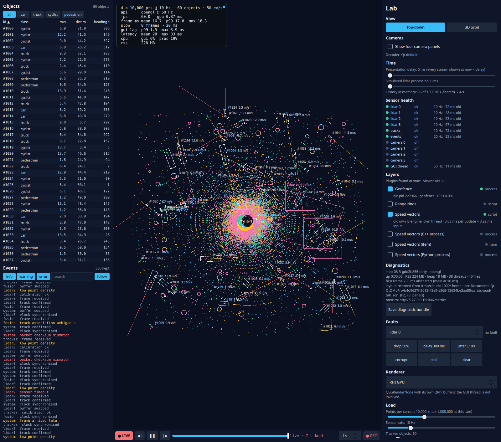
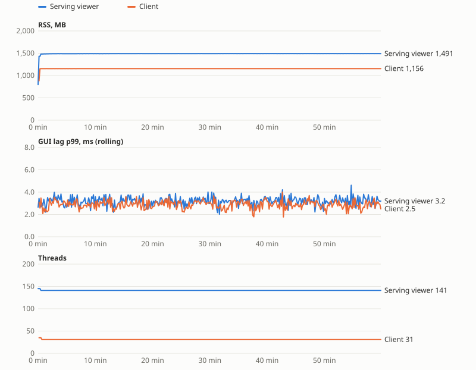

# Step 9: shipped, observed, healthy for hours

**What the user sees:**
- **Saved layout:** the viewer comes back as it was left: view, renderer, level of detail, presentation delay, cameras, layers, panels (F2, F3) and window size.
- **Diagnostics section** in the lab panel:
  - the build (git version) and graphics API;
  - uptime, memory, threads and open files;
  - how long start-up took;
  - where the layout came from;
  - a button that saves a **diagnostic bundle**.
- **Behind it:**
  - a JSON-lines log, rotated by size;
  - a metrics endpoint on localhost (`--set metricsPort=9100`, `curl localhost:9100/metrics`);
  - an installable package that runs without the Qt installation.

**The design question:** how is it shipped, observed and kept healthy for hours?



## Observed from outside

> **Intermediate:** We have the lab panel's charts. Why a metrics endpoint?
>
> **Senior:** The charts are for the person at the screen, while it runs. Operations need the opposite:
> - **Someone else** can look at the viewer: a script, a dashboard, the person you're on a call with.
> - **Nobody is watching**, at three in the morning, for hours.
> - **Afterwards**, a problem report can be understood by someone who never saw the screen.
>
> So the viewer answers three ways: numbers on a port (`/metrics`, one line per number), a bundle (`/bundle`, or the button, or `--set bundleOnExit=<file>`), and a log. The bundle has build identity, arguments, environment, layout, every stream's health, every layer's status, resources, and the last 200 log lines.

The metrics are the diagnostics snapshot flattened: `qp_process_rssMb`, `qp_frames_lagMsP99`, `qp_health_notOk`, `qp_layers_failing`, `qp_network_peers`, `qp_stages_storedValues`, and so on. They are served from their own thread. Being watched costs nothing measurable ([`analysis.md`](../../results/step-09/analysis.md)):

| Scraped | GUI lag p99 | Frame p99 | Process CPU |
|---|---|---|---|
| not at all | 3.21 ms | 17.9 ms | 35.8% |
| once a second | 2.91 ms | 17.8 ms | 35.3% |
| ten times a second | 2.99 ms | 17.8 ms | 35.9% |

### The observer was on the GUI thread

The first version sampled everything once a second on the GUI thread:
- the process (`/proc`, `mallinfo2()`);
- the parts: health, layers, timeline.

The soak showed the sample taking **2.4 ms every second, peaking at 5.35 ms**, which is over the 4 ms GUI-lag budget by itself.

| On the GUI thread, per second | Median | Max |
|---|---|---|
| Everything (as built; from the soak) | 2.41 ms | 5.35 ms |
| Only the viewer's own parts; process on its own thread | **0.085 ms** | 0.158 ms |

`mallinfo2()` alone takes 1.1 ms (max 1.9). It walks every malloc arena holding its lock, and any thread that allocates meanwhile waits. It now runs every 10 s on the sampler thread. **Measuring is work, and it belongs where the work it measures doesn't run.**

## Stopped by the system, not only by the user

`timeout`, `systemctl stop` and logging out all send SIGTERM. The first version died on it: no layout saved, no bundle, and the log simply stopped. Now:
- a signal handler writes one byte to a socket;
- the event loop wakes and quits;
- the viewer shuts down exactly as when the window is closed, and the log says why: `asked to stop by a signal`, `stopped (exit 0)`.

## The layout

- **When it's written:** a second after a change, and at exit.
- **How:** atomically (`QSaveFile`): a crash mid-write leaves the old file.
- **Format:** `{"version": 1, "values": {...}}`.

| Situation | What happens (`tst_ops`) |
|---|---|
| No file | Defaults |
| Damaged file (random bytes) | Set aside as `layout.json.bad-<time>`, defaults, a warning in the log; the next save writes a good file |
| Written by a newer viewer (`version: 99`) | Keys it knows are applied; the file is **never overwritten** |
| Keys this version doesn't know | Kept on save |
| Five changes in a second | One write |
| An option given on the command line | Wins for this run, and **is not saved** |

> **Intermediate:** Why does the last row matter?
>
> **Senior:** The first version saved whatever was current. One run with `--set cameras=0` turned the cameras off in the saved layout, and the next plain start came up without cameras. A command-line option is for one run; the user's choice is the user's.
>
> Benchmarks never read or write a layout. A measurement that depends on how someone last left the window isn't a measurement.

## The package

`cmake --install build/release --prefix <dir>`: `bin/viewer`, the Qt libraries, plugins and QML modules it uses (Qt's deploy script), and `share/qtqmlpro/` (plugins, camera videos).

- **Read-only data:** an installed viewer reads from `share/qtqmlpro`.
- **Writable data:** logs, bundles and recordings go to `~/.local/share/QtQMLPro/…`; the layout goes to `~/.config/QtQMLPro/…`.
- **The build tree:** a build-tree viewer keeps everything next to itself, as before.

| | |
|---|---|
| Size | 301 MB: libraries 142 (ICU data 32, FFmpeg's codec library 15), camera videos 94, the viewer 54 (2.1 stripped), translations 8 |
| Install time | 1.5–2.2 s |
| With `/opt/Qt` hidden (`bwrap --tmpfs /opt`) | Runs: lidar, cameras (FFmpeg), all three layers |
| First version | **Ran through XWayland**: Qt's deploy script ships only the X11 platform plugin. The Wayland plugin is now listed explicitly |
| Also deployed, unused | Every Controls style (Imagine, FluentWinUI3, …): at least 9 MB the viewer never loads (it sets Basic) |

Start-up, 10 runs each, nominal load with cameras, warm cache. Times are measured from the process's start (`/proc`, 10 ms resolution):

| | `main()` | QML loaded | First frame |
|---|---|---|---|
| Build tree | 20 ms | 180 ms | **250 ms** (250–270) |
| Package, `/opt/Qt` hidden | 20 ms | 180 ms | **250 ms** (250–270) |

> **Intermediate:** The package isn't slower?
>
> **Senior:** Same libraries, same loader, different directory. What differs is what you can't see from the build tree: which files exist, which platform plugin loads, where it may write. Hiding `/opt/Qt` is what turns "it runs" into "it runs without the thing I forgot to ship". It caught the missing Wayland plugin.

## An hour, watched from outside

The serving viewer runs nominal lidar, four cameras and three layers, with a client connected. The client is a second viewer. A script scrapes both every 10 s for an hour, and nothing else watches.

**Soak 1, as built:**

| Per hour, after minute 5 | Serving viewer | Client |
|---|---|---|
| RSS | **+42.6 MB** | **+15.6 MB** |
| Heap in use | +11.3 MB | +10.0 MB |
| Threads / open files | 140 / 65, flat | 30 / 30, flat |
| History, events kept | at their bounds (999 MB, 10,000) | same |

> **Intermediate:** Both grow about 10 MB of heap an hour, and everything with a bound is at its bound.
>
> **Senior:** So look for something without a bound that both processes have. It's the stage statistics, the per-stage timings every chart and benchmark report reads. They keep every value so a benchmark can compute exact percentiles. A benchmark lasts 20 seconds and resets after warm-up; a viewer in use never resets. The metric we added says it: **981 values a second, 28 MB an hour**. Nothing outside a benchmark reads more than recent values. Now they are a window of the newest 10,000 per stage outside benchmarks, and complete inside them.

**Soak 2, with the window:**

| Per hour, after minute 5 | Serving viewer | Client |
|---|---|---|
| RSS | **+1.8 MB** (1,489–1,492) | **+0.4 MB** (1,155–1,156) |
| Heap in use | +1.5 MB | +0.3 MB |
| Threads / open files | 141 / 65, flat | 31 / 30, flat |
| GUI lag p99 (rolling) | 3.1–3.2 ms settled, 2.0–4.6 range, no trend | 2.9 ms, no trend |
| fps / frame p99 | 60 / 17.7 ms | 60 / 17.7 ms |
| Latency mean | 24.7 ms | 29.2 ms |
| Unhealthy streams, failing layers, disconnections | none in 360 samples | none |
| Log | 4 lines, 1 kB | 4 lines |
| Exit on SIGTERM | 0, nothing on stderr | 0 |



> **Intermediate:** The stage values are still rising at the end of soak 2.
>
> **Senior:** Toward a bound: windows for slow stages take longer to fill. It's the stages times 10,000 values, about 3 MB. A rising line with a known ceiling is a cache; one without a ceiling is a leak. That's why the count is a metric: next time it's a number on a dashboard, not a guess.

## Predictions against measurements

Predictions: [`results/step-09/predictions.md`](../../results/step-09/predictions.md).

| Prediction | Measured | |
|---|---|---|
| Restoring the layout: < 5 ms | Not measured on its own; first frame at 250 ms | – |
| Damaged or newer settings never stop the start | Tested: set aside / read-only | Right |
| Serving metrics: unmeasurable | Within run-to-run noise at 1 and 10 Hz | Right |
| Package 150–250 MB | 301 MB, of which 94 MB camera videos | More |
| Start-up the same packaged, ~300–600 ms | 250 ms both | Right, faster |
| Package runs with `/opt/Qt` hidden | Yes, after adding the Wayland plugin; at first it fell back to X11 | Right, after a fix |
| RSS < 20 MB drift in an hour | 43 MB (as built), 1.8 MB (fixed) | Wrong, then right |
| Threads and files flat | Flat in both soaks | Right |
| GUI lag p99 under 4 ms, no trend | No trend; rolling peaks to 4.6 ms, partly the diagnostics sample itself | Mostly |
| The client stays connected | 360 of 360 samples | Right |
| The soak finds something without a bound | Stage statistics: 981 values/s | Right |

What the harness got wrong along the way:
- **A leftover viewer:** the start-up script stopped the packaged viewer by signalling `bwrap`, which doesn't pass signals on. The viewer kept running through the first metrics runs. Those were discarded and re-run, and the script now signals the process group.
- **A scraper that outlived its run:** a closure bug in the metrics script let one run's 10 Hz scraper keep going into the next. That was found from the scrape counts, and the runs were repeated.

## Decision

- **Observe from outside:**
  - metrics on localhost, from their own thread;
  - a bundle on demand and on exit;
  - a JSON-lines log, rotated at 5 MB with 3 kept, for state changes and warnings only.
- **Measuring runs off the GUI thread;** the GUI thread only gathers its own cheap state.
- **SIGTERM is a normal stop.**
- **Layout:**
  - versioned, atomic, debounced;
  - damaged files are set aside;
  - newer files are read and never overwritten;
  - command-line options are not saved;
  - benchmarks don't use it.
- **Package:** an install tree with Qt deployed and the Wayland plugin listed explicitly, tested with `/opt/Qt` hidden. Read-only data lives in `share`; writable data in the user's directories.
- **Everything that grows has a bound and a metric:** history, the event log, plugin queues, logs, stage statistics.

| It would be the wrong choice if… | …then |
|---|---|
| The viewer runs unattended in a fleet | Push metrics to a collector (or Prometheus scraping); bundles uploaded on crash; a watchdog restarting the viewer |
| Package size matters (embedded, downloads) | Strip; exclude unused styles and plugins; ship ICU only if needed; videos separately |
| Users need to move layouts between machines | Named layouts, exported and imported; window geometry kept per screen |
| Weeks of uptime | Soak for longer than an hour, at peak load and with replay; watch heap fragmentation (heap free) and GPU memory, which nothing here measures |

## Run it

```bash
build/release/app/viewer --set metricsPort=9100 &   curl localhost:9100/metrics
cmake --install build/release --prefix build/package
bwrap --dev-bind / / --tmpfs /opt -- build/package/bin/viewer        # without the Qt installation
python3 scripts/step09_runs.py startup && python3 scripts/step09_runs.py metrics
python3 scripts/step09_runs.py soak --minutes 60 --name soak2 && python3 scripts/step09_report.py
build/release/app/tst_ops
git checkout step-09
```
