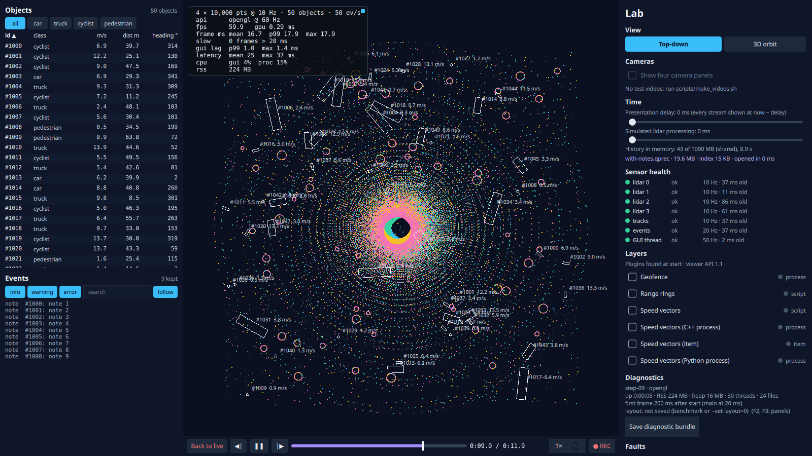

# Step 10: design review — does the design survive change?

**What the user sees:**
- **More lidars:** the viewer takes up to eight lidars (`--sensors 8`), in every view, in health and in faults.
- **Notes:** the operator can put a note on an object (select it, type, Enter). The note appears:
  - where the object was;
  - in the event log;
  - on a second viewer;
  - in recordings, at the time of the scene it was made on.
- **Memory:** on a machine with little memory, the viewer keeps less history instead of being killed.

**The design question:** does the design survive requirements it never saw? Three were applied to the finished viewer (`step-09`), with predictions written before any change ([`predictions.md`](../../results/step-10/predictions.md)).



## How to review a design

> **Intermediate:** We've measured everything for nine steps. What's left to review?
>
> **Senior:** Whether the boundaries are in the right places. A design is a bet on what will change, and a review is where you collect on it. Take a requirement nobody planned for and write down two things before you touch the code: which parts will change, and which will hold. Then make the smallest change that works and compare.
>
> - **A good design:** the guess was right, the change stays inside the boundaries, and nothing that worked stops working.
> - **A weak spot:** the change spreads into places that "shouldn't know", or something breaks far away.
>
> Both are worth finding.

## A. Eight lidars

**Guess:**
- **Changes:** 8–12 files: the simulator, the option, stream numbering, colour tables, health.
- **Holds:** none in the pipeline, history, recording or wire.

**Change:** 15 files with code, none in the pipeline's processing, history, presenter, recording or wire.

| Where the "4" lived | What it was |
|---|---|
| The option (`--sensors 1-4`) | A limit |
| Stream numbers | Tracks is stream 4. Lidars 4–7 were given 11–14: the numbers are an interface (fault options, scripts, event text), so new ones are **appended, never renumbered**, the same rule as the file format |
| Colour tables in three renderers and the QML; the simulator's sensor mounts | Arrays of 4, indexed with `& 3`: sensor 4 would silently share sensor 0's colour and position |
| Both 3D views | `Repeater3D { model: 4 }`: sensors 4–7 would simply not be drawn |
| Health configuration and the "hide stale lidar" rule | Loops to 4 |
| The fault menu and the names of health events | Hard-coded lists |

| 20 s, cameras off | GUI lag p99 | Frame p99 | GPU per frame | Lidar frames shown | CPU | Recording |
|---|---|---|---|---|---|---|
| 4 × 150k @ 10 Hz | 2.82 ms | 17.7 ms | 1.54 ms | 40/s of 40 | 26% | 21.9 MB/s, all frames |
| 8 × 150k @ 10 Hz | 3.00 ms | 17.6 ms | 2.86 ms | 80/s of 80 | 29% | 43.6 MB/s, all frames |

> **Intermediate:** Twice the points, the GUI thread doesn't notice, and the GPU time doubles. Exactly what we wanted.
>
> **Senior:** Because the data path never knew how many sensors there were: per-sensor mailboxes, ids on every frame, records with a stream field. The count lived in the edges: the option, the tables, the views, the lists. Those are cheap to change, but notice the failure mode. **None of them failed loudly.** A colour mask, a `model: 4` and a bounds check that drops quietly all produce a picture that looks fine. Only looking for sensor 7 shows it's missing.

### The one that got through: the second viewer

| Over the wire, 8 lidars | Received | Shown |
|---|---|---|
| As built | 43.8 MB/s | **40 frames/s: half** |
| Client sized for the protocol | 43.8 MB/s | 80 frames/s |

- **The bug:** the client sized its store and pipeline from *its own* command line (default: 4 sensors). It received sensors 4–7 and dropped them without a word, because the mailbox's bounds check discards quietly.
- **The fix:** a client is sized for what the protocol can carry (eight). Sensors that never send stay *off* in health.

The rule is the same one as step 8's: **the receiver is sized by the contract, not by its own configuration.**

Looking at that path turned up a worse bug, older than this step. The wire carries any 16-bit stream number, and the client indexed the health monitor's fixed arrays with it. A buggy or hostile server sending sensor 20 would have made the client write past the end of an array. Before this step, sensors 4–10 would have landed on other streams' health (4 is tracks), and 11 and above past the end. Now:
- **At ingest:** the timeline rejects sensor ids it has no place for, and counts them.
- **In health:** the monitor ignores stream numbers it doesn't have (`tst_viewer: healthIgnoresStreamsItDoesNotHave`).

Step 6 validated the *contents* of frames at ingest, and step 7 put a network in front of ingest. Nobody re-checked the *addressing*.

## B. Operator notes

**Guess:**
- **Changes:** a new record type: 8–10 files across the codec, recording reader/writer, presenter, wire, timeline, a model and the QML.
- **Holds:** old viewers skip the new type.

**Change:** no new record type at all. A note is an **event with an anchor**: the object, its position, and the capture time of the scene the operator was looking at. Event items already carry their own size, so the anchor is appended to the item (events version 2), and readers that don't know it skip it. Twelve files changed, and **none of them is the recording reader or writer, the presenter, the history or the wire parser**. Notes travel, record and replay because events already do.

| [`compat.md`](../../results/step-10/compat.md) | Result |
|---|---|
| New viewer replays its own recording | Notes shown at their time (9 in 10 s) |
| **Old viewer (`step-09`, built from the tag) replays the new recording** | Plays, nothing on stderr, and **shows the notes as text in its event log** (screenshot above) |
| New viewer replays step 4 recordings | Plays |
| Old client, new server sending notes | Connected; notes arrive as events |
| New client, old server | Connected |
| New client, new server | Notes shown (10 in 10 s) |

> **Intermediate:** The old viewer showing the text is better than what I predicted.
>
> **Senior:** Skipping is the floor; degrading is better. A new record type would have been invisible to every old viewer. An appended field leaves old viewers with everything they understand. The review found a smaller change than the guess because the format had a place for *extension within a type*, not only *new types*.
>
> The new channel came with a cost. In step 7, events to a slow client are a bounded queue that drops the oldest, and that's fine for 2,000 machine events a second. An operator's note is rare and is the one thing you must not drop. Now a queued batch that holds a note is never the one dropped (`tst_wire: slowClientKeepsNotes`). Without that rule the test loses the note: checked by removing it.

## C. A smaller machine

**Guess:**
- **Changes:** nothing.
- **Holds:** two cores would sit at the edge of the GUI-lag budget, and with cameras they would be over it.

These runs used the unchanged `step-09` code:

| | GUI lag p99 | Frame p99 | Lidar frames shown | CPU |
|---|---|---|---|---|
| Nominal + cameras, 16 cores | 2.98 ms | 17.9 ms | 40/s of 40 | 35% |
| Nominal + cameras, 2 cores | 2.92 ms | 18.2 ms | 40/s of 40 | 28% |
| Nominal + cameras, **1 core** | 3.20 ms | 18.0 ms | 40/s of 40 | 25% |
| Peak + cameras, 16 cores | 2.10 ms | 17.8 ms | 80/s of 80 | 48% |
| Peak + cameras, **1 core** | **4.04 ms** | 18.4 ms | 80/s of 80 | 38% |

> **Intermediate:** One core handles the peak load with cameras. I guessed two would struggle.
>
> **Senior:** Steps 1–3 moved the work off the CPU: points go to the GPU as they are, video decodes in hardware, and nothing copies a frame twice. What's left is under half a core. So I asked what a smaller machine is actually short of. Look at the RSS: 1.2–1.5 GB, most of it the history's fixed 1 GB budget.

| Under a 1 GB memory limit (cgroup, no swap) | Outcome |
|---|---|
| As built: history budget 1 GB | **Killed by the kernel after 12 s**: no log line, no bundle |
| History budget = 30% of the memory available, 64 MB–1 GB | Ran 148 s; 532 MB (838 MB with cameras); history 321 MB = 4.4 s |

- **What changed:** one file. The budget now follows the machine: the smaller of RAM and the process's cgroup limit.
- **The trade-off:** history is short at 4.4 s. Step 4's int16 history shape would double it.
- **What didn't change:** on this 29 GB machine the budget is still 1 GB, so earlier measurements stand.

**A constant that was a good default on the development machine is a requirement on every other one.**

## Scorecard

| | Guess: files | Actual | Guess right about what holds? | Broke silently before the change? | Found on the way |
|---|---|---|---|---|---|
| A. Eight lidars | 8–12 | 15 | Yes: no data-path changes | **Yes**: masks, `model: 4`, quiet bounds checks; client dropped half | An unchecked stream number from the network |
| B. Notes | 8–10, new record type | 12, no new type | Better than guessed: no format, recording or wire code | No | Notes must not be dropped for slow clients |
| C. Smaller machine | 0 | 1 (memory) | Cores: yes, wrongly pessimistic. Memory: not considered | **Yes**: OOM-killed in 12 s | Fixed budgets are requirements |

What held across all three: **every data path that takes an identifier instead of a count, and every format that lets readers skip what they don't know.** What didn't: **numbers that encoded the development setup**:
- the count 4;
- the 1 GB budget;
- the client's own sensor count;
- the assumption that a stream number from the network fits an array.

## Predictions against measurements

| Prediction | Measured | |
|---|---|---|
| A: 8–12 files, none in the data path | 15 files; data path untouched | Right about where, low on how many |
| A: GUI lag within 0.5 ms of 4 lidars | +0.18 ms | Right |
| A: frame p99 < 20 ms, GPU time doubles | 17.6 ms; 1.54 → 2.86 ms | Right |
| A: latency unchanged | 25.4 → 22.2 ms p50: lower. With twice the frames, the newest on screen is younger | Better |
| A: history same bytes, half the seconds | Same budget | Right |
| A: recording keeps up at ~44 MB/s | 43.6 MB/s, every frame | Right |
| A: second viewer fine | It showed half the lidars until the client was sized for the protocol | **Wrong** |
| B: new record type, 8–10 files | Anchored events, 12 files, no format code | Wrong, in the good direction |
| B: old viewer skips annotations | Old viewer shows them as text | Better |
| B: new reads old, old/new over the wire | All work | Right |
| C: 2 cores at the GUI-lag edge; over with cameras | 2 cores: 2.9 ms; 1 core at peak with cameras: 4.04 ms | Wrong: cores were not the constraint |
| C: nothing changes | Memory: OOM-killed in 12 s as built | **Wrong**: the constraint was memory |

## Decision

- **Identifiers, not counts,** in every data path; counts only at the edges, and the edges checked by looking for the last item (sensor 7), not the first.
- **Numbers that are interfaces** (stream numbers, record types, option values) are appended, never renumbered.
- **Extension within a type** (appended fields with sizes) before new types: old readers degrade instead of going blind.
- **Receivers are sized by the contract;** anything addressed from outside is range-checked before it indexes anything.
- **Budgets follow the machine** (memory available, cgroup limits), with the decision logged.
- **Not everything in a stream is equal:** rare high-value items (notes) are exempt from drop-oldest.

| Still open | Why it matters |
|---|---|
| More than eight lidars | `kMaxSensors` is now the one place the count lives, but colour tables and sensor mounts still need one entry per sensor |
| A second case study (e.g. a low-rate, high-reliability embedded HMI) | Would show which of these lessons are about real-time visualizers and which are general |
| GPU memory, heap fragmentation, peak-load soak | Not measured (step 9) |

## Run it

```bash
build/release/app/viewer --sensors 8 --points 150000
build/release/app/viewer --set annotateEvery=2              # or select an object and type a note
python3 scripts/sweep.py step-10 && python3 scripts/step10_report.py
python3 scripts/step10_compat.py <step-09 viewer>           # build the tag in a worktree first
python3 scripts/step10_wire.py
python3 scripts/memlimit.py mem-1g 1G 150 --points 150000 --objects 200 --events 200 --set cameras=0
git checkout step-10
```
