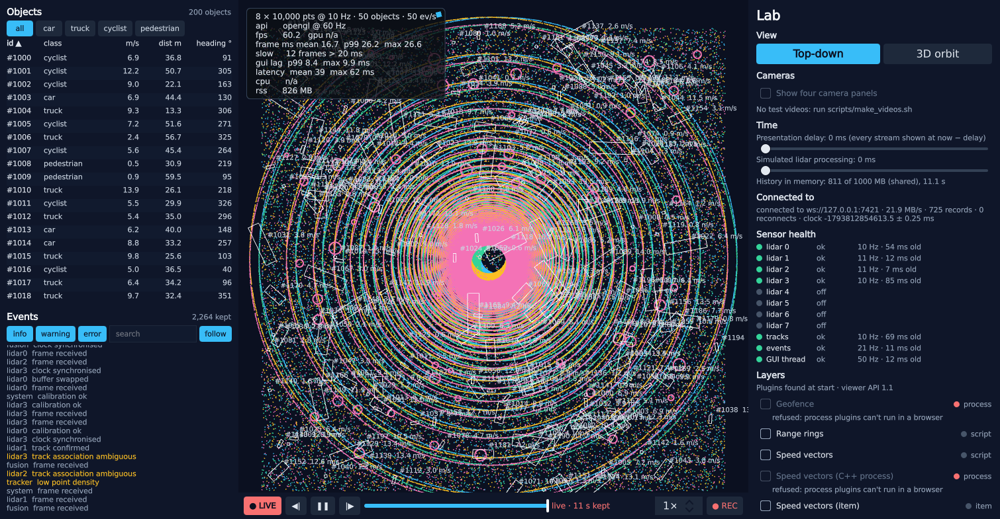

# Step 11: the viewer in a browser

**What the user sees:**
- **The viewer in a tab:** the same viewer runs in a browser tab (Firefox here), built from the same QML and C++ with Qt's WebAssembly kit.
- **What it shows:** the live scene of a desktop viewer (`--set serveWs=<port>` on the desktop; the page connects over a WebSocket), or its own simulator.
- **What carries over:** layers, the timeline and the lab panel all work in the tab, and the layout survives a reload.
- **Process plugins** are listed as refused, with the reason: a page can't start processes.

**The design question:** what did the design assume about the platform? Predictions were written before any change ([`predictions.md`](../../results/step-11/predictions.md)); every number below is in [`analysis.md`](../../results/step-11/analysis.md).



> **Intermediate:** Qt builds for WebAssembly. Isn't this a compile flag?
>
> **Senior:** The compile is the easy part. It built with one error (`mallinfo2`, a glibc call) and ran the first time. A port is where you find out which of your design's assumptions were really facts about your desktop. Ten steps of measurements were made on one machine, with one clock, one kernel, real sockets and a render thread. Take those away and see what breaks.

## What the browser took away

| Desktop assumption | In the page | What happened |
|---|---|---|
| Processes | None | Process plugins refused at load, with the reason; script and item layers work |
| `/proc`, `getrusage`, `mallinfo2` | None | The harness read CPU 100%/0% and memory 0 MB; the history budget fell back to its 64 MB minimum (under 2 s) |
| Files | An in-memory filesystem, gone on reload | The layout was lost on every reload |
| `exit()` | Without Asyncify, Qt makes `exit()` fatal (`qFatal`) | Every benchmark ended in `Aborted()` |
| A 2 ms timer | Browsers clamp repeating timers to 4 ms | The GUI-lag probe read 2 ms of lag on an idle page |
| Threads on demand | Web Workers, 4 made ahead of time | The other 6 of the viewer's 10 start once the main thread yields |
| A render thread | Rendering on the one main thread | See *The main thread* |
| TCP | WebSockets only | A WebSocket endpoint, the same records |
| **The clock** | A page's clock is not the server's | See *Clocks* |
| **The socket as credit** | A browser reads every message as it arrives | See *A client that falls behind* |

The first rows are what you'd expect from a port: each one is a capability, switched off or replaced at build time:
- **Measured differently:** CPU reads *n/a*; memory is the WebAssembly heap.
- **Read from the right place:** start-up times come from the page's navigation start.
- **Stored elsewhere:** the layout file is mirrored to `localStorage`.
- **Sent elsewhere:** the benchmark report is PUT to a URL instead of written to a file.

The last two rows are design assumptions the port exposed, and they fail silently on desktops too.

## Clocks

The first run in the browser reported a latency of 1,793,812,854,650 ms, and health marked every lidar *late*.

> **Intermediate:** That's the Unix epoch in milliseconds. The browser's clock counts from 1970?
>
> **Senior:** Here, yes. The serving viewer's clock counts from boot. The wire carries capture times in the server's clock, and every consumer (latency, health, the presentation clock) compared them with its own. Two viewers on one machine share the monotonic clock, so step 7 never noticed. Two machines would have failed exactly like the browser did, and it only took a browser to show it.

On the desktop, the same bug reproduces with a skewed clock (`--set clockOffsetMs`, a new fault):

| Desktop client, server clock | Latency the client reports | Lidar frames/s shown |
|---|---|---|
| +5 s, as built | −4,970 ms | 40 |
| −5 s, as built | +5,030 ms | 40 |
| +5 s, **200 ms presentation delay**, as built | **224 ms** | **31.6**: nothing shown for the first 5 s |

The last row is the dangerous one. Frames stamped 5 s in the future wait in history until the client's clock catches up, so the screen is 5 s behind. The latency the client measures looks perfect, because the measurement shares the wrong clock.

**The fix:** two-way probes (Cristian's algorithm, NTP's core):
- **The probe:** the client sends its time; the server echoes it with its own. offset = server − (sent + rtt/2), wrong by at most rtt/2.
- **The filter:** of the last 16 probes, the one with the shortest round trip wins. A probe that waited behind a backlog carries a long round trip, not a wrong offset.
- **Seeding:** the hello carries the server's clock, an estimate before the first answer.
- **Where it's applied:** every capture time is converted to the client's clock at ingest, so nothing downstream knows there were two clocks.
- **Compatibility:** probes go only to servers whose hello offers them.

| | Offset found | Latency p50 |
|---|---|---|
| Desktop, server +5 s | 5,000.00 ms ± 0.06 | 29.2–29.7 ms (no skew: 29.3–30.3) |
| Desktop, server −5 s | −4,999.99 ms | 29.0–29.3 ms |
| With the 200 ms delay, server +5 s | 5,000.01 ms | 40 frames/s, from the first second |
| Browser | −1,793,812,854,614 ms ± 0.15 | 36.1–37.3 ms |

## A client that falls behind

> **Intermediate:** Step 7's slow-client policy used the socket's backlog as the client's credit. A browser has a socket.
>
> **Senior:** But the page doesn't read it. The browser reads every message as it arrives and hands it to the page. If the page is slow, messages wait inside the page, where the server can't see them.

The fault: `--set clientDelayMs=50` makes the client spend 50 ms on every lidar record, about half of the 40 that arrive each second.

| Slow client, as built | Server backlog | Server dropping stale frames | Latency, 3 s → 75 s | Client memory |
|---|---|---|---|---|
| Desktop, TCP | 1.1 MB | 1,978 | 960 → 569 ms | flat (history) |
| Desktop, WebSocket | 1.1 MB | 1,979 | 689 → 473 ms | flat |
| **Browser** | **0** | **0** | **2.8 s → 41 s** | **heap 258 → 1,114 MB; tab 465 → 1,708 MB** |

The browser case is the prediction from the start of the step: the server thinks the client is keeping up while the page queues everything, latency climbs by half a second every second, and memory grows until the 4 GB address space runs out.

**The fix: credit at the application level.** The client reports the bytes it has *processed*, at least every 64 KB, and the server holds records back while sent-but-unprocessed bytes exceed a window. Step 7's policies then apply unchanged: latest-wins per stream, the bounded event queue, notes never dropped. The hellos switch it on, so old clients and old servers never see it ([`compat.md`](../../results/step-11/compat.md)).

| Slow client, with credit (4 MB window) | Server dropping stale frames | Latency, 3 s → 75 s | Heap |
|---|---|---|---|
| Desktop, TCP | 2,047 | 502 → 382 ms | flat (history) |
| Desktop, WebSocket | 2,053 | 261 → 256 ms | flat |
| Browser (3 runs) | 2,035–2,073 | 508–518 → 331–334 ms | 179 → 215 MB, then flat |

> **Intermediate:** The desktop clients got better too.
>
> **Senior:** Because the socket's backlog only counts the server's side. The kernel buffers at both ends are a queue too: step 7 measured 330–655 ms behind for a slow client. Credit counts everything that's been sent and not yet processed, wherever it waits.

### How big a window

The window is the most a client may have unprocessed: a slow client's latency is about window ÷ the rate it processes. The first version reused the socket's high-water mark, 1 MB. At peak load (4 × 300k @ 20 Hz, 800 objects, 2,000 events/s) one lidar record is about 1.1 MB, so the server sent one record and waited for its credit: stop-and-wait.

| Window, browser client | Peak: lidar frames/s shown (of 80) | Peak: latency p50 | Slow client: latency p50 |
|---|---|---|---|
| 1 MB | 47.6–56.9 | 82–86 ms | 169 ms |
| **4 MB** | **68.3–68.6** | **99–102 ms** | **336 ms** |
| 8 MB | 67.6 | 131 ms | 556 ms |
| 1 GB (no limit: as built) | 70.3–71.1 | **3.8–4.6 s, still climbing (max 6.4–7.4 s)**; heap → 1 GB | – |

> **Intermediate:** The last row is the as-built browser at peak. One run earlier looked fine: 77 frames a second, 55–73 ms.
>
> **Senior:** That run sat just under the page's capacity; these three sat just over it, and without credit "just over" means without bound. A client near its limit is the normal case at peak, not an exotic fault. So credit isn't only for broken clients, and the window is a real trade: 1 MB halves what a fast client gets, and 8 MB lets a slow one fall half a second behind. 4 MB keeps 86% of peak and bounds a slow client at a third of a second.

Other ways a tab falls behind, measured with credit (1 MB window; the client kept up in both):
- **Hidden for 30 s:** rendering stops (one frame a second, each showing what arrived at the one before), but receiving doesn't: the client runs on a worker, which the browser doesn't throttle. Latency is 35–43 ms within a second of returning, and the heap is flat.
- **Main thread 60% busy for 30 s** (a script): fps 34–46, latency 50–93 ms, flat, and back to 34–43 ms after.

My prediction for a hidden tab (memory grows until it is in front again) was wrong: the receiving thread was never the one the browser slows down.

## The main thread

| Nominal load, cameras off | GUI lag p99 | Frame p99 | Labels | Latency p50 |
|---|---|---|---|---|
| Desktop client | 2.66–2.81 ms | 17.6–17.7 ms | 2.13–2.20 ms | 29.0–30.1 ms |
| Browser, idle page (no data at all) | **3.86–4.10 ms** | 19.9–20.4 ms | – | – |
| Browser client, no labels | 5.36–6.22 ms | 22.2–23.8 ms | 0.4 ms | 36.1–37.8 ms |
| Browser client | 7.59–8.24 ms | 24.4–25.5 ms | 2.97–2.98 ms | 36.1–37.3 ms |

> **Intermediate:** The idle page alone is at the 4 ms budget.
>
> **Senior:** That's the browser's floor on this machine, measured with a probe that ticks every 4 ms, the fastest a page may repeat a timer. The service level was written for a desktop, where Qt owns the event loop. Here three things share one thread: the browser's own work, the scene graph's render (1.4 ms a frame, which the desktop does on a render thread), and our GUI work, about 1.35× slower as WebAssembly.

Where the time goes:
- **Labels:** about 200 object labels, re-shaped each track update inside the sync phase, which blocks the GUI thread on every platform. They were a `QTextLayout` each. One layout with a line per label, each line placed at its object, draws the same picture (23 pixels at glyph edges differ, by at most 9 of 255 levels) and costs 18% less: browser 3.48 → 2.84 ms, desktop 2.49 → 2.06 ms. Kept, because it helps both platforms, but it didn't move the browser's p99.
- **The rest:** render on the main thread, the track model rebuild (1.2 ms), and the browser's floor.

**Decision:** the 4 ms GUI-lag service level stays for the desktop. In the browser the floor is measured first, and the budget is what our work adds above it: about 1.5–2 ms without labels, about 4 ms with them. Frame p99 (22–26 ms) misses the 20 ms target: a dropped frame every few seconds at nominal load. Labels are the next lever: shaping them off the GUI thread, or fewer of them in a browser.

## Memory, start-up and the rest

- **History:** a page can't see the machine. Chrome reports `navigator.deviceMemory` (coarse); Firefox reports nothing. Every page knows its ceiling, the 4 GB WebAssembly address space. The budget is 30% of the smaller of the two, capped at 1 GB, the same rule as step 10. A 90 s run filled 1 GB (heap 1,114 MB within 12 s, flat after) with 60 fps and nothing on stderr: 14 s of history instead of under 2. **The risk:** a small device whose browser admits to nothing gets 1 GB too. Emscripten warns that threads plus a growing heap can slow JavaScript's access to it (Qt's default build); the 90 s fill grew the heap from 372 MB to 1,114 MB at 60 fps, so the cost wasn't visible here.
- **Start-up** (localhost, ms from navigation start):

| | First visit (fresh profile) | Reload | Desktop (step 9) |
|---|---|---|---|
| First frame | 686–700 | 619–696 | 250 |

  - **Download:** `viewer.wasm` is 38.8 MB.
  - **The worker pool:** making 10 Web Workers ahead of time, instead of Qt's default 4, made the first visit 25–30 ms *slower*, so the default stays. The six late threads start as soon as the main thread yields. The hazard is a main thread that blocks waiting for a thread that hasn't started: that deadlocks in a page. `StreamServer::start()` blocks that way, and serving can't happen in a page anyway.
- **Layout:** the layout file is mirrored to the browser's `localStorage`, so it is restored before loading and kept after saving. A view changed before a reload is still there after it; as built, it wasn't ([`layout-reload.png`](../../results/step-11/layout-reload.png)).
- **Security:** the WebSocket endpoint accepts pages from local origins only, or from origins listed in `--set wsOrigins`. Any web page can open a WebSocket to `localhost`; without the check, any site the user visits could read the stream (`tst_wire: webSocketOrigins`).

## Predictions against measurements

| Prediction | Measured | |
|---|---|---|
| WebSocket endpoint, same records, parser unchanged | Yes; latency within noise of TCP (29.0–30.1 vs 29.3–30.3 ms p50) | Right |
| A slow tab's backlog moves into the browser | Server backlog 0 while the page queued 41 s and 1.1 GB; at peak load too | **Right** |
| Background tab: memory grows | Flat: the client runs on a worker, which the browser doesn't throttle | Wrong |
| zstd: compile it in or send uncompressed | Compiled from its pinned release | Right |
| Process plugins unavailable; script and item layers work | Yes | Right |
| History budget falls back to the minimum | 64 MB, as built | Right |
| Layout doesn't survive a reload | Lost, as built | Right |
| GPU time column empty | Empty (no timestamp queries in WebGL) | Right |
| `exec()` never returns | Worse: `exit()` is fatal without Asyncify | Right, harder |
| Download 30–60 MB, first load 2–5 s | 38.8 MB; first frame at 0.7 s from localhost | Faster |
| Frame p99 ≤ 20 ms | 24–26 ms (the idle page alone: 20 ms) | Wrong |
| GUI lag p99 4–8 ms | 7.6–8.2 ms; the idle floor 3.9–4.1 ms | Right, at the top |
| WASM ~1.5× slower | ~1.35× (labels, track model) | About right |
| Latency 40–60 ms | 36–37 ms | Better |
| *(not predicted)* The clock | Latency of 56 years; frames held 5 s while the metric read 224 ms | **Missed** |

The biggest finding wasn't in the predictions: a shared clock was a hidden assumption since step 7. It was the third time a measurement shared the assumption it should have checked:
- the latency metric used the same clock;
- the GUI-lag probe assumed a 2 ms timer;
- the backlog metric assumed the socket was the queue.

## Decision

- **Capabilities, not platforms:** each missing capability is switched off where it lives (process plugins, `/proc`, `exit()`, files), and the rest of the code doesn't know.
- **Times cross processes in one clock:** the receiver converts at ingest, from probes with the shortest round trip. Clock skew is a fault the lab can inject.
- **Credit is what the receiver has processed,** not what its socket holds; the window covers several records (4 MB: a fast client keeps 86% of peak, a slow one stays within a third of a second).
- **Budgets follow what the platform admits to**, with the cap where it doesn't.
- **Measure the platform's floor first;** service levels are about what our work adds to it.
- **The probes match the platform:** the lag probe ticks at the browser's minimum; memory is the WebAssembly heap; CPU is *n/a*, not a wrong number.

| It would be the wrong choice if… | …then |
|---|---|
| Viewers run on machines that must agree on wall time (recording from two sites) | A shared time source (PTP or NTP on the hosts), with probes kept as the check |
| The browser is the main target, on small devices | Labels off the GUI thread or fewer; a memory budget the user can set; a smaller download (compression, fewer Qt modules) |
| Many browser clients per server | Encode once is still right; credit is per client, and replaced records cost nothing extra |

| Still open | Why it matters |
|---|---|
| Cameras in the browser | Not measured: Qt Multimedia uses the browser's video element, and the 94 MB of test videos would need serving |
| Chrome | Not installed; `navigator.deviceMemory` and Chrome's timer and worker behaviour are untested |
| The page's GUI-lag budget | The floor is 3.9–4.1 ms; labels are the next lever |

## Run it

```bash
source ~/emsdk/emsdk_env.sh                                  # Emscripten 5.0.5
cmake --preset wasm && cmake --build build/wasm --target viewer
build/release/app/viewer --set serve=7420 --set serveWs=7421 &
python3 scripts/webserve.py &                                # COOP/COEP, reports, logs
firefox "http://127.0.0.1:8000/app/index.html?a=--no-sim&a=--set&a=connect=ws://127.0.0.1:7421"
python3 scripts/step11_browser.py client 3 && python3 scripts/step11_behind.py slow-browser 3
python3 scripts/step11_report.py
git checkout step-11
```
