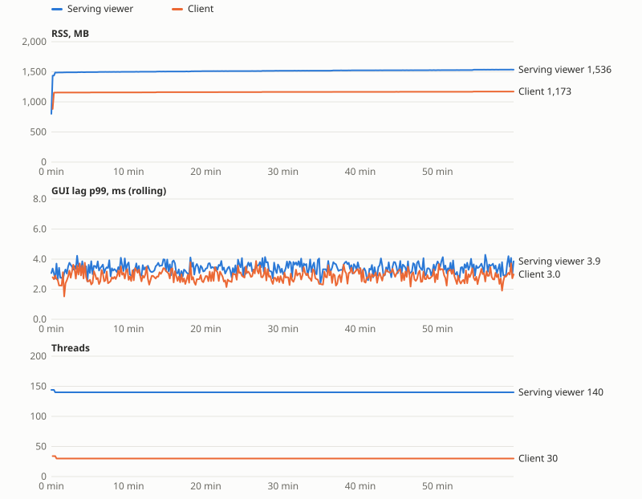
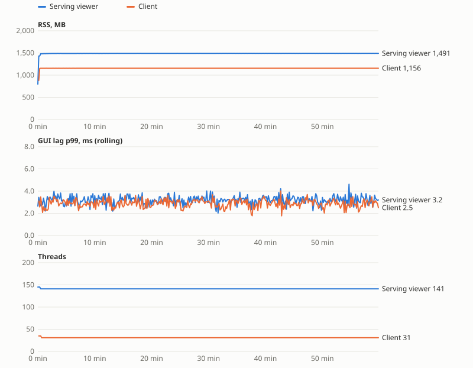

# Step 9 analysis

## Start-up

Milliseconds since the process started (from /proc, 10 ms resolution): median (min–max). Warm file cache. Nominal load, cameras on.

| Where | Runs | main() entered | QML loaded | First frame | Runs with stderr |
|---|---|---|---|---|---|
| build tree | 10 | 20 (10–20) | 180 (170–200) | 250 (250–270) | 0 |
| package, /opt/Qt hidden | 10 | 20 (20–20) | 180 (180–200) | 250 (250–270) | 0 |

## Cost of being watched

Nominal load, cameras on, 20 s, metrics served on localhost and scraped at the given rate.

| Scraped | n | GUI lag p99 | Frame p99 | GUI CPU | Process CPU |
|---|---|---|---|---|---|
| not scraped | 2 | 3.21 | 17.9 | 7.0 | 35.8 |
| 1 Hz | 2 | 2.91 | 17.8 | 6.7 | 35.3 |
| 10 Hz | 2 | 2.99 | 17.8 | 6.9 | 35.9 |

## Soak 1: stage statistics keep every value (as built)

360 samples, one every 10 s, 60 minutes. Serving viewer: nominal lidar, four cameras, three layers, one client connected. Client: a second viewer showing the first one's streams. Both watched only through their metrics endpoints. *Settled* is minutes 5–10; *end* is the last 5 minutes; *slope* is a least-squares fit after minute 5, per hour.

### Server

| Metric | Settled | End | Slope per hour | Min | Max |
|---|---|---|---|---|---|
| RSS (MB) | 1,498 | 1,535 | 42.6 | 1,495 | 1,537 |
| Heap in use (MB) | 1,327 | 1,342 | 11.3 | 1,325 | 1,343 |
| Heap free (MB) | 90 | 101 | 12.3 | 88 | 102 |
| Threads | 140 | 140 | 0.0 | 140 | 140 |
| Open files | 65 | 65 | -0.1 | 65 | 67 |
| CPU (%) | 52 | 52 | 0.2 | 47 | 58 |
| fps | 60.0 | 59.9 | -0.04 | 58.9 | 60.1 |
| Frame p99 (ms) | 17.7 | 17.7 | -0.05 | 17.1 | 18.4 |
| GUI lag p99 (ms) | 3.44 | 3.49 | 0.034 | 2.41 | 4.29 |
| Latency mean (ms) | 25.2 | 24.7 | -0.33 | 21.9 | 28.0 |
| History (MB) | 999 | 999 | -0.0 | 999 | 999 |
| Events kept | 10,000 | 10,000 | 0.0 | 10,000 | 10,000 |
| Diagnostics sample (ms) | 2.56 | 2.51 | -0.000 | 1.88 | 5.78 |

Unanswered scrapes: 0. samples with no client: 1

### Client

| Metric | Settled | End | Slope per hour | Min | Max |
|---|---|---|---|---|---|
| RSS (MB) | 1,157 | 1,172 | 15.6 | 1,157 | 1,173 |
| Heap in use (MB) | 1,039 | 1,050 | 10.0 | 1,037 | 1,051 |
| Heap free (MB) | 24 | 27 | 2.6 | 23 | 28 |
| Threads | 30 | 30 | 0.0 | 30 | 30 |
| Open files | 30 | 30 | 0.0 | 30 | 30 |
| CPU (%) | 30 | 30 | -0.1 | 26 | 34 |
| fps | 60.0 | 59.9 | -0.02 | 59.0 | 60.1 |
| Frame p99 (ms) | 17.7 | 17.7 | -0.04 | 17.1 | 18.5 |
| GUI lag p99 (ms) | 2.82 | 2.86 | 0.050 | 1.90 | 3.88 |
| Latency mean (ms) | 29.2 | 29.4 | 0.18 | 26.0 | 33.6 |
| History (MB) | 999 | 999 | 0.0 | 999 | 999 |
| Events kept | 10,000 | 10,000 | 0.0 | 10,000 | 10,000 |
| Diagnostics sample (ms) | 1.08 | 1.18 | 0.068 | 0.61 | 2.96 |

Unanswered scrapes: 1. Every sample: all streams ok, no layer failing, connected.

Exit: `{"client": {"exit": 0, "stderr": []}, "server": {"exit": 0, "stderr": []}}`

Log `soak1-logs`: 1 file(s), 1 kB, 6 lines: info/viewer 3, info/health 2, info/diagnostics 1

Log `soak1-logs-client`: 1 file(s), 1 kB, 4 lines: info/viewer 3, info/diagnostics 1

## Soak 2: stage statistics keep the newest 10,000 values per stage

360 samples, one every 10 s, 60 minutes. Serving viewer: nominal lidar, four cameras, three layers, one client connected. Client: a second viewer showing the first one's streams. Both watched only through their metrics endpoints. *Settled* is minutes 5–10; *end* is the last 5 minutes; *slope* is a least-squares fit after minute 5, per hour.

### Server

| Metric | Settled | End | Slope per hour | Min | Max |
|---|---|---|---|---|---|
| RSS (MB) | 1,490 | 1,491 | 1.8 | 1,489 | 1,492 |
| Heap in use (MB) | 1,317 | 1,318 | 1.5 | 1,315 | 1,320 |
| Heap free (MB) | 91 | 91 | 0.4 | 89 | 93 |
| Threads | 141 | 141 | 0.0 | 141 | 141 |
| Open files | 65 | 65 | -0.0 | 65 | 67 |
| CPU (%) | 52 | 52 | 0.1 | 47 | 58 |
| fps | 60.0 | 59.9 | 0.03 | 59.0 | 61.0 |
| Frame p99 (ms) | 17.7 | 17.7 | 0.03 | 17.0 | 18.5 |
| GUI lag p99 (ms) | 3.13 | 3.22 | 0.084 | 2.01 | 4.62 |
| Latency mean (ms) | 24.2 | 24.7 | 0.38 | 21.7 | 28.3 |
| History (MB) | 999 | 999 | -0.0 | 999 | 999 |
| Events kept | 10,000 | 10,000 | 0.0 | 10,000 | 10,000 |
| Diagnostics sample (ms) | 2.41 | 2.50 | 0.151 | 1.84 | 5.35 |
| Stage values kept | 165,218 | 230,464 | 53,133.3 | 147,677 | 230,899 |

Unanswered scrapes: 0. samples with no client: 1

### Client

| Metric | Settled | End | Slope per hour | Min | Max |
|---|---|---|---|---|---|
| RSS (MB) | 1,155 | 1,156 | 0.4 | 1,155 | 1,156 |
| Heap in use (MB) | 1,038 | 1,039 | 0.3 | 1,037 | 1,039 |
| Heap free (MB) | 23 | 23 | 0.2 | 22 | 25 |
| Threads | 31 | 31 | 0.0 | 31 | 31 |
| Open files | 30 | 30 | 0.0 | 30 | 30 |
| CPU (%) | 29 | 30 | 0.2 | 26 | 34 |
| fps | 59.9 | 60.0 | 0.08 | 59.0 | 60.1 |
| Frame p99 (ms) | 17.7 | 17.7 | 0.03 | 17.0 | 18.9 |
| GUI lag p99 (ms) | 2.85 | 2.87 | -0.049 | 1.77 | 4.01 |
| Latency mean (ms) | 29.6 | 29.2 | -0.38 | 25.7 | 33.4 |
| History (MB) | 999 | 999 | -0.0 | 999 | 999 |
| Events kept | 10,000 | 10,000 | 0.0 | 10,000 | 10,000 |
| Diagnostics sample (ms) | 0.97 | 0.98 | 0.085 | 0.64 | 2.04 |
| Stage values kept | 78,059 | 93,562 | 12,853.0 | 72,414 | 93,707 |

Unanswered scrapes: 1. Every sample: all streams ok, no layer failing, connected.

Exit: `{"client": {"exit": 0, "stderr": []}, "server": {"exit": 0, "stderr": []}}`

Log `soak2-logs`: 1 file(s), 1 kB, 4 lines: info/viewer 3, info/diagnostics 1

Log `soak2-logs-client`: 1 file(s), 1 kB, 4 lines: info/viewer 3, info/diagnostics 1

## Stage statistics, 4 minutes

Stored values, from the metrics endpoint between minute 1 and minute 4 (three layers, nominal load).

| Kept | Growth (values/s) | Stored at 4 min |
|---|---|---|
| every value | 981 | 235,920 |
| newest 10,000 | 382 | 127,344 |
